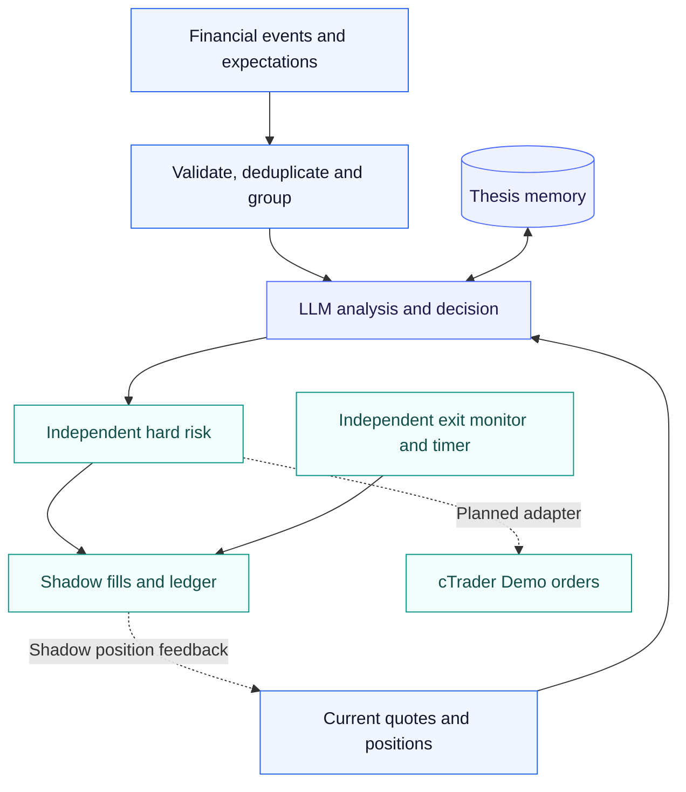

<p align="center">
  
</p>

<p align="center">
  <a href="https://github.com/lohis-aimbot/eventlens/actions/workflows/tests.yml"></a>
  <a href="pyproject.toml"></a>
  <a href="#roadmap"></a>
</p>

<p align="center">
  <strong>Financial events · Persistent context · Independent risk</strong><br />
  A Python foundation for an LLM-driven intraday trading system.
</p>

<p align="center">
  <a href="#overview">Overview</a> ·
  <a href="#architecture">Architecture</a> ·
  <a href="#quickstart">Quickstart</a> ·
  <a href="#evidence">Evidence</a> ·
  <a href="#roadmap">Roadmap</a>
</p>

---

## Overview

EventLens is a Python research system built around **Event → Thesis Memory → Position**. Existing LLM APIs interpret financial events, maintain persistent trading theses and propose intraday exposure changes. Independent rules validate proposals, enforce risk limits and manage exits in a local Shadow ledger. The intended holding period is minutes to hours, with positions closed within the configured trading day.

> [!NOTE]
> **v0.15.6 · Shadow research foundation.** Event ingestion (`investingLive` live HTML streams + `ECB`, `Fed`, `US BEA`, `Forex Factory`), single-pass LLM reasoning with optional bounded stateful thesis re-evaluation (`ReviewPolicy` + `runtime_reviews`), durable bundle crash recovery, quote-wait vs. model-retry separation, deterministic hard risk (including stale/degraded-source risk gating), pips-based stop/take-profit/trailing exits, strictly read-only `shadow status`/`report` with bounded-anchor objective diagnostics, explicit publication/latency taxonomy, 4-dimensional source health evaluation, and historical bar-replay provenance separation are implemented and verified offline (`347` passing tests). Prior real observations (`v0.15.3`–`v0.15.4`) remain preserved unmodified under local ignored `data/`. **Live forward acceptance of the `investingLive` HTML channel and `v0.15.5`–`v0.15.6` runtime paths remains pending; no broker orders are connected, and profitability has not been established.**

<table>
  <tr>
    <td width="33%" valign="top"><strong>01 / Event</strong><br /><br />New information.<br />Clear evidence.</td>
    <td width="33%" valign="top"><strong>02 / Context</strong><br /><br />Relevant memory.<br />Revisable beliefs.</td>
    <td width="33%" valign="top"><strong>03 / Control</strong><br /><br />Bounded actions.<br />Independent risk.</td>
  </tr>
</table>

News categories remain open research questions: macro, policy, energy, geopolitical, company and later social events are candidates. Existing EUR/USD × FOMC experiments are a bounded case study, not the future system's news whitelist.

## Architecture

**Current Shadow workflow**, with broker execution shown as a planned extension. Shadow fills are local simulations using observed Demo quotes; they are not broker orders.



One Python process and SQLite are sufficient initially. Analysis and decision can use one call or two isolated LLM roles; their reliability, latency and cost still need comparison. LLMs have no broker credentials and cannot override operator limits. Protective exits must operate without the model. No model training, RL, microservices or multi-agent framework is required.

**Design target: 30–60 seconds from first verified public release to the decision/order workflow under eligible conditions.** This is not a measured guarantee or a promise of fills. Original release, publisher display, receipt, analysis, order and fill times must remain distinct; unknown original release time stays unknown.

### What works today

| Layer | Implemented | Next capability |
|---|---|---|
| **Information** | Tier-1 English (`investingLive` live HTML RSC/DOM streams, `ECB`, `Fed`, `US BEA`, `Forex Factory`) + legacy WallStreetCN capture, independent per-stream publication, non-regressing official full-text enrichment, 4-dimensional stream health (`http_transport`, `cache_observation`, `content_activity`, `verifiable_lag`), timestamp taxonomy (`original_published_at` vs. `publisher_display_at` vs. `modified_at` vs. `scheduled_at`), and explicit `Consensus Forecast: MISSING` handling | Live forward acceptance of the `investingLive` HTML channel and multi-session source observation |
| **LLM & memory** | DeepSeek JSON adapter, single-pass thesis + exposure proposals, optional stateful thesis re-evaluation (`review_at`, periodic review, structured price rules separated from non-executable natural language, `runtime_reviews` trace, dedup/cooldown/call budgets), durable `runtime_event_bundles` crash recovery, and immutable SQLite history | Broader forward evaluation of decision quality, review utility, failures and cost |
| **Market data** | Offline Bid/Ask tools, bounded Demo EURUSD quote bridge (`10–86400s`), Razor commission metadata, strict separation of `live_poll` vs. `synthetic_fixture` vs. `historical_bar_replay` provenance, and cutoff-consistent single-session objective diagnostics | Continuous uninterrupted live coverage and authoritative broker positions |
| **Research** | Historical input cutoffs (including strict `as_of` anti-lookahead on enriched full text), repo-tracked bar-replay assumptions & arrival-time sensitivity (`scripts/run_historical_bar_replay.py`), opt-in LLM replay, costs, delays and recovery | Integrated strategy evaluation and forward observation |
| **Trading** | Explicit `IGNORE_EVENT`/`HOLD`/`SET_TARGET`/`CLOSE` actions (including reversal & momentum prompts, never auto-trading on breakouts), quote-wait validity window (`awaiting_market_quote` → `expired`), stale-source risk gate (blocking new/increased risk while preserving `CLOSE` and protective exits), pips-based SL/TP/trailing exits, strictly read-only `shadow status`/`report`, two-phase protective drain and cutoff guards | Uninterrupted Shadow protection and position reconciliation before cTrader Demo execution |

[Read the architecture and module map →](docs/architecture.md)

## Quickstart

**Python 3.11+** · Start with the offline tools. No API key is needed for these examples.

```bash
python3 -m venv .venv
source .venv/bin/activate
python -m pip install -e '.[dev]'

# Explore the command groups
eventlens --help

# Capture invented news/calendar inputs offline into a dedicated demo database
eventlens observe demo examples/synthetic-observer.json

# Validate a synthetic proposal; execution remains disabled
eventlens research decision check examples/synthetic-position-proposal.json

# Inspect a frozen research plan without calling a model
eventlens research series plan examples/synthetic-series-plan.json
```

| Command group | Purpose |
|---|---|
| `eventlens observe …` | Tier-1 English FX/central-bank capture (`capture`), macro window schedule (`schedule`), offline demo and timing audits |
| `eventlens shadow …` | Bounded single-process automated Shadow loop (`start`, `stop`, `status`, `report`, `recover`) with simultaneous release bundling |
| `eventlens memory …` | Memory inspection, synthetic demo and explicit memory reasoning |
| `eventlens source fed …` | Existing Fed polling collector; use `--help` to inspect options |
| `eventlens research …` | Historical data, accounting, proposal validation and opt-in inference |

The `demo`, `check` and `plan` examples above are offline. The demo writes invented, explicitly tagged records to `data/observer-demo.sqlite`. Live intake (`eventlens observe capture` and `eventlens shadow start --poll-news`) defaults to the **Tier-1 English FX & official macro stack** (`investingLive` FX desk wire, official `ECB` press & statistical releases, official `Federal Reserve` monetary & speech feeds, official `US BEA` GDP/PCE releases, and `Forex Factory` weekly schedule JSON), with simultaneous release bundling (`--bundle-events`) and explicit `Consensus Forecast: MISSING` separation when consensus estimates are absent. Paid research inference remains separate and opt-in. The optional quote watcher reads a separate, explicitly started Demo bridge; it does not invoke an LLM. All eight older `eventlens-*` commands remain available.

Shadow sizing is configuration-driven: the CLI defaults to `pepperstone_razor_200` (modeled equity of $200 and 200x leverage); `--account-profile institutional_10k` selects the unleveraged $10,000 profile. These are local simulation settings, not balances read from a broker account.

<details>
<summary><strong>Capture Tier-1 English FX/macro feeds and inspect key macro windows</strong></summary>

```bash
# Inspect upcoming high/medium EUR & USD macro windows (Beijing Time + UTC, explicit MISSING consensus markers)
eventlens observe schedule --hours 36

# One bounded cycle across Tier-1 English feeds (investingLive, ECB, Fed, US BEA, ForexFactory); no API key needed
eventlens observe capture

# Read the resulting local capture report without network access
eventlens observe report
```

The first snapshot is a baseline. Later captures retain new records, edits and duplicates without replacing earlier evidence. Calendar schedules and publisher display times are distinct from original release time, which remains unknown. This uses website endpoints without a documented public service guarantee. See [observer operation and timing](docs/observer.md) and [source-capture acceptance](docs/observer-acceptance.md). A separate [Demo quote bridge](docs/live-quotes.md) supports time-alignment audits; it does not place orders.

</details>

<details>
<summary><strong>Model setup and existing command compatibility</strong></summary>

For model setup, see [memory reasoning](docs/reasoning.md) and [historical inference](docs/research/replay-inference.md). Never put credentials in chat, source files or Git.

Relocated Python modules use `eventlens.sources.*`, `eventlens.trading.*` and `eventlens.research.*`; old Python import paths are not aliases. Console commands and `python -m eventlens.<existing>_cli` remain compatible. Research config paths, database formats and frozen experiment content are unchanged.

</details>

## Evidence

### Live Shadow observation · October 23, 2026

Two bounded EUR/USD observation windows covered France and Germany Flash PMI releases. The original unleveraged Shadow records show:

| Observation | Recorded result | What it establishes |
|---|---|---|
| Demo quote capture | **1,786 quotes** across two sessions | Recorded Bid/Ask and availability clocks; not executable liquidity |
| LLM and memory | **6 structured model results**, 5 committed memory versions | Event interpretation, thesis updates and one rejected target are traceable |
| Shadow lifecycle | **2 entries, 1 timed protective exit** | One complete entry/exit cycle; the second position remained open at the final report |
| Event receipt → shadow fill | **4.974 s / 14.151 s** for the two entries | Two observations, not a latency distribution or verified public-release-to-fill timing |
| Costs | Commission and assumed slippage recorded in the ledger | Inspectable simulated accounting, not broker-confirmed fills or profitability |

**Coverage limit:** the October 23 runs were two separate sessions with an approximately five-minute runner gap while the first position was open, predating two-phase protective drain and cutoff guards.

### Live recovery & uninterrupted Shadow window · October 27, 2026

Following the two-phase drain, cutoff-window and cost-provenance updates, a follow-up live session verified residual position recovery and continuous operation:

| Observation | Recorded result | What it establishes |
|---|---|---|
| Residual open-position recovery (`09:30 UTC`) | **Both Oct 23 open positions closed on fresh live quotes** (`unclosed_risk = false`, cent-level PnL/fee reconciliation) | Recovery without historical price backfilling; multi-day offline mark change is not strategy alpha |
| Uninterrupted runtime (`12:25–13:02 UTC`) | **2,240.0 s continuous session** (`2.33×` `max_holding_seconds + exit_buffer_seconds`), `3,517` live quotes (`0` rejected) | Continuous operation across US Durable Goods and Home Price Index windows with clean `flat_completed` drain |
| Protection coverage | **10,761 checks** (`9,653` fresh valid quotes, `0` unavailable checks while holding an open position) | Continuous protection monitoring; quiet `> 2.0 s` inter-tick pauses fail closed without synthetic quotes |
| Full event accounting | **84 events persisted** (`77` filtered, `5` `IGNORE_EVENT` model decisions, `2` stale-quote fail-closed rejections) | Honest retention of ignored and rejected arrivals (`0` forced entries when prints lack actionable surprise) |

Raw SQLite/JSONL evidence remains local under ignored `data/` paths. The [Shadow observation and acceptance report](docs/shadow-acceptance.md) describes the captures, account profiles and limitations. Results from different sizing profiles must not be combined or presented as additional live trades.

The base quote policy rejects zero spread. The CLI's default `pepperstone_razor_200` profile enables the commission-bearing exception for allowlisted sources with clock provenance and commission metadata; `--no-allow-commission-zero-spread` disables it. Raw Bid/Ask are preserved. Platform metadata and modeled costs do not independently establish executable prices. See [Demo quote observation and policy](docs/live-quotes.md).

### Earlier model and historical research checks

The chronological FOMC study covers **eight historical episodes**. It checks integration, memory continuity and restart behavior, not trading performance.

| Observation | Result | Interpretation |
|---|---|---|
| Evidence-valid position proposals | **3 / 8**, all flat | Five replies were rejected; this is not forecast accuracy |
| Mean two-stage processing | **7.443 s** | Excludes realtime feed, order delivery and fills |
| Single-pass API smoke check (`v0.15.2`) | **3.854 s** (1 call, valid) | Adapter/schema connectivity using a stored event; not a realtime trading-chain measurement |
| Pause and resume | Completed without duplicate requests | Recovery evidence, not execution readiness |
| Historical market data and costs | Demo gaps and assumed execution costs | Preserved research limitations; insufficient for a profitability claim |

[Historical FOMC acceptance →](docs/research/fomc-series-acceptance.md) · [Historical market-data limitations →](docs/research/fomc-2025-data-quality.md)

### Verification boundary

EventLens strictly separates four epistemic statuses across documentation and reports:
- **Implemented (`已实现`)**: Stateful thesis re-evaluation (`ReviewPolicy`, `parse_invalidation_condition`, `runtime_reviews`), historical bar-replay provenance separation (`replay_provenance.py`, `scripts/run_historical_bar_replay.py`, `configs/fomc_2026_10_28_replay_assumptions.json`), bounded-anchor & cutoff-consistent objective diagnostics (`_build_objective_diagnostics`), timestamp & latency taxonomy (`original_published_at` / `publisher_display_at` / `modified_at` / `scheduled_at` / `received_at` / `available_at` + missing-consensus preservation), strictly read-only `shadow status`/`report` (`?mode=ro` without DB creation, schema migration, daily rollover writes, or order cancellation), and 4-dimensional source health evaluation + stale-source new-risk gating.
- **Offline-verified (`离线验证`, `347 passing tests`)**: CI on Python 3.11 and 3.12 verifies all `v0.15.3`–`v0.15.6` contracts, state machines, crash recovery, provenance gates, read-only invariants, diagnostic gap/outage/cutoff edge cases, timestamp taxonomy, DOM-breakage/cache/timeout source health, hard risk, and shadow ledger math using deterministic offline mocks and clocks (`pytest -q`, `ruff check .`, `ruff format --check .`, `mypy src scripts`).
- **Live-observed (`真实观测`, preserved unmodified)**: Recorded across October 22–29, 2026 under local gitignored `data/` (`v0.15.3` Oct 23 PMI runs, Oct 27 live-quote recovery and `2,240.0 s` continuous window, and Oct 29 ECB window where `investingLive` RSS CloudFront `Age: 313s` lag and a mid-session quote-bridge outage were observed) plus the 8-episode historical FOMC study. Separately, the ad-hoc October 28 1-minute Yahoo bar replay is quarantined as synthetic/bar-level analysis only—see [October 28 replay errata & quarantine](docs/replay-errata-2026-10-28.md). `HOLD`, zero fills, or single-run PnL are never evaluated as strategy success.
- **Pending live forward acceptance (`待验收`)**: Live forward Shadow verification of the `investingLive` live HTML channel (`live_forward_acceptance_status = "pending"`—a single HTTP `X-Cache: Miss` check does not prove zero-lag delivery), live forward verification of stateful thesis reviews and `v0.15.5`–`v0.15.6` remediation paths, live open-to-exit fills within a single uninterrupted post-drain window, multi-session after-cost evaluation, and isolated cTrader Demo order execution remain pending.

## Roadmap

- [x] **Foundation** — typed contracts, durable evidence and thesis memory, model adapter.
- [x] **Historical tools** — time-aware replay, cost accounting and restart-safe experiments; model reliability remains insufficient.
- [x] **Repository organization** — separate source, research and trading modules; preserve existing commands and experiment identity.
- [ ] **Realtime observer** — source/quote capture, Razor ECN commission-metadata provenance and sub-second bridge flush are implemented; broader multi-session observation remains pending.
- [ ] **Evaluation & protection (Shadow loop)** — risk, accounting, protective drain, cutoff guards, residual-position live recovery and a `2,240 s` uninterrupted Shadow window are recorded above, awaiting independent review and broader live trade-cycle coverage.
- [ ] **cTrader Demo** — isolated execution adapter and reconciled positions after live Shadow acceptance passes.

**Next acceptance gate:** keep quotes and independent protection running through the full position lifecycle, document every exit or explicit handoff, and retain all ignored, rejected and failed events alongside successful decisions. News/provider selection remains open. Additional AI roles must demonstrate value against a simpler baseline.

[Stage objectives and acceptance criteria →](docs/roadmap.md)

### Long-horizon research agenda

Planned research extensions beyond the current Shadow and Demo milestones remain strictly subordinate to independent hard risk and must outperform simpler baselines before adoption:

| Research pillar | Stage | Technical scope |
|---|---|---|
| **Neuro-Symbolic Execution Governance & Formal Safety Verification** | **Active architectural pillar** | Decouples stochastic LLM semantic interpretation (`SinglePassTradingAgent`) from deterministic symbolic state-transition guards (`DeterministicTargetValidator`, `DeterministicHardRiskEngine`), extending toward stateful property-based testing (`Hypothesis`) and SMT-backed formal invariant verification (`Z3`) across quote outages, session rollovers and protective drain. |
| **Conditional Generative Market World Model** | **Medium-horizon research** | Mitigates macro-event sample scarcity via conditional trajectory generation—jointly modeling post-release price jumps, liquidity droughts and spread-widening dynamics—for offline counterfactual stress testing of sizing and exit policies, benchmarked against historical bootstrap baselines. |
| **Self-Exciting Microstructure Regime Detection (Hawkes Point Processes)** | **Medium-horizon research** | Models clustered information arrivals and sub-second tick-intensity bursts with Hawkes point processes to detect informed order-flow and adverse-selection regimes for execution gating and adaptive exit calibration. |
| **Regularized Programmatic Policy Search** | **Gated long-horizon research** | Restricts evolutionary program/parameter search (FunSearch / Eureka paradigm) to bounded execution and exit policies under walk-forward validation, Deflated Sharpe Ratio penalties and generative stress-test gates to control multiple-testing bias. |

## Repository

```text
eventlens/
├── src/eventlens/
│   ├── sources/         Tier-1 English, Fed, cTrader Demo and WallStreetCN adapters
│   ├── observer.py      Raw captures, revisions, enrichments and availability history
│   ├── quotes.py        Demo quote evidence and as-of input alignment
│   ├── research/        Historical data, replay and experiments
│   ├── trading/         Agent, sizing, hard risk and Shadow execution/accounting
│   ├── contracts.py     Shared typed records and UTC validation
│   ├── deepseek.py      Replaceable JSON model boundary and adapter
│   ├── reasoning.py     Existing memory-only LLM path
│   ├── sqlite_memory.py Durable evidence and thesis history
│   ├── runtime.py       Intraday event runtime, persistent state and ShadowRunner
│   ├── shadow_cli.py    Bounded Shadow loop CLI (start/stop/status/report/recover)
│   └── cli.py           Grouped access to existing commands
├── tests/               Shared, source and research checks
├── configs/             Pinned research configurations
├── docs/                Architecture, roadmap and research evidence
├── ctrader/             Read-only Demo quote bridge & backtesting probe
├── scripts/             Research utilities
├── notebooks/           Existing data-quality and cost diagnostics
├── examples/            Synthetic inputs and schema examples
└── data/                Local ignored evidence; not committed
```

<details>
<summary><strong>Development checks</strong></summary>

```bash
pytest -q
ruff check .
ruff format --check .
mypy src scripts
```

CI runs offline/synthetic checks on Python 3.11 and 3.12, without paid model or broker calls. Keep output validity, predictive quality and after-cost performance separate.

</details>

## Documentation

| Start here | Research and operations |
|---|---|
| [Architecture](docs/architecture.md) | [Research replay](docs/research/research-replay.md) |
| [Roadmap](docs/roadmap.md) | [Historical input boundaries](docs/research/historical-context.md) |
| [Observer capture](docs/observer.md) | [Source-capture acceptance](docs/observer-acceptance.md) |
| [Demo quote observation](docs/live-quotes.md) | [Quote/alignment acceptance](docs/live-quotes-acceptance.md) |
| [Shadow loop & acceptance](docs/shadow-acceptance.md) | [Chronological replay and recovery](docs/research/chronological-replay.md) |
| [Thesis memory](docs/memory.md) | [Historical implementation snapshot](docs/research/implementation-history.md) |
| [Fed intake](docs/fed-intake.md) | [Oct 28 replay errata & quarantine](docs/replay-errata-2026-10-28.md) |

---

<p align="center"><sub>EventLens · Evidence before exposure.</sub></p>
