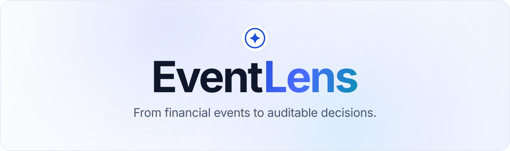
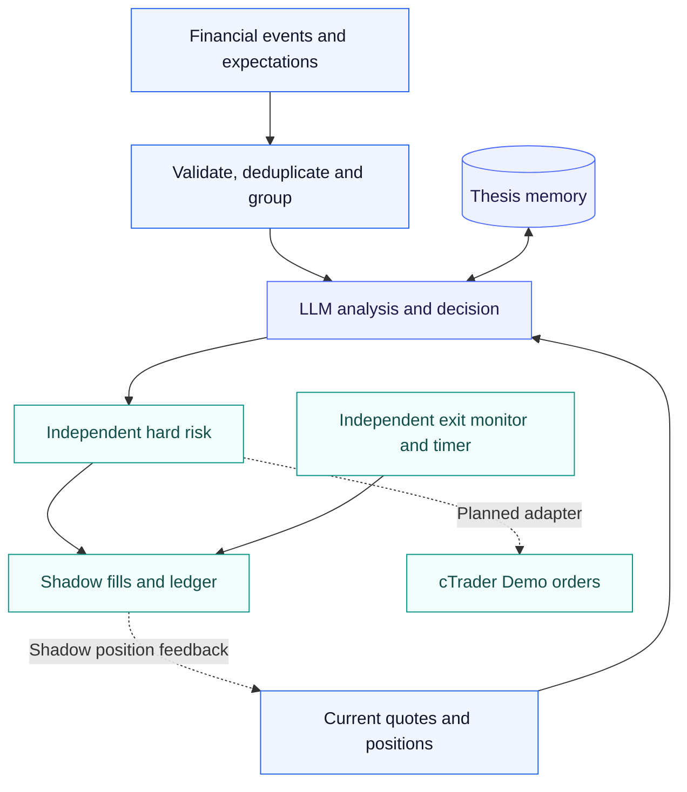

<p align="center">
  
</p>

<p align="center">
  <a href="https://github.com/lohis-aimbot/eventlens/actions/workflows/tests.yml"></a>
  <a href="pyproject.toml"></a>
  <a href="#roadmap"></a>
</p>

<p align="center">
  <strong>Financial events · Persistent context · Independent risk</strong><br />
  A Python foundation for an LLM-driven intraday trading system.
</p>

<p align="center">
  <a href="#overview">Overview</a> ·
  <a href="#architecture">Architecture</a> ·
  <a href="#quickstart">Quickstart</a> ·
  <a href="#evidence">Evidence</a> ·
  <a href="#roadmap">Roadmap</a>
</p>

---

## Overview

EventLens is a Python research system built around **Event → Thesis Memory → Position**. Existing LLM APIs interpret financial events, maintain persistent trading theses and propose intraday exposure changes. Independent rules validate proposals, enforce risk limits and manage exits in a local Shadow ledger. The intended holding period is minutes to hours, with positions closed within the configured trading day.

> [!NOTE]
> **v0.15.3 · Shadow research foundation.** Event ingestion, single-pass LLM reasoning, thesis memory, deterministic risk checks and Shadow accounting are implemented. Two bounded live PMI observation windows recorded model decisions, shadow entries and a timed exit. Protective drain shutdown and cutoff guards have since been added; uninterrupted operation and complete position reconciliation remain pending acceptance. **No broker orders are connected, and profitability has not been established.**

<table>
  <tr>
    <td width="33%" valign="top"><strong>01 / Event</strong><br /><br />New information.<br />Clear evidence.</td>
    <td width="33%" valign="top"><strong>02 / Context</strong><br /><br />Relevant memory.<br />Revisable beliefs.</td>
    <td width="33%" valign="top"><strong>03 / Control</strong><br /><br />Bounded actions.<br />Independent risk.</td>
  </tr>
</table>

News categories remain open research questions: macro, policy, energy, geopolitical, company and later social events are candidates. Existing EUR/USD × FOMC experiments are a bounded case study, not the future system's news whitelist.

## Architecture

**Current Shadow workflow**, with broker execution shown as a planned extension. Shadow fills are local simulations using observed Demo quotes; they are not broker orders.



One Python process and SQLite are sufficient initially. Analysis and decision can use one call or two isolated LLM roles; their reliability, latency and cost still need comparison. LLMs have no broker credentials and cannot override operator limits. Protective exits must operate without the model. No model training, RL, microservices or multi-agent framework is required.

**Design target: 30–60 seconds from first verified public release to the decision/order workflow under eligible conditions.** This is not a measured guarantee or a promise of fills. Original release, publisher display, receipt, analysis, order and fill times must remain distinct; unknown original release time stays unknown.

### What works today

| Layer | Implemented | Next capability |
|---|---|---|
| **Information** | Fed RSS plus WallStreetCN news/calendar capture, EUR/USD observation filter, raw responses, receipt/availability clocks and revision history | Wider source validation, representative quote alignment and long-running observation |
| **LLM & memory** | DeepSeek JSON adapter, single-pass thesis + exposure proposals, source-evidence validation and immutable SQLite history | Broader forward evaluation of decision quality, failures and cost |
| **Market data** | Offline Bid/Ask tools plus bounded Demo EURUSD quote bridge (`10–86400s`), Razor commission metadata, raw-tick/clock diagnostics and as-of alignment | Continuous uninterrupted live coverage and authoritative broker positions |
| **Research** | Historical input cutoffs, opt-in LLM replay, costs, delays and recovery | Integrated strategy evaluation and forward observation |
| **Trading** | Explicit `IGNORE_EVENT`/`HOLD`/`SET_TARGET`/`CLOSE` actions, account sizing profiles, independent hard risk, SQLite shadow fills/PnL, protective drain and cutoff guards | Uninterrupted Shadow protection and position reconciliation before cTrader Demo execution |

[Read the architecture and module map →](docs/architecture.md)

## Quickstart

**Python 3.11+** · Start with the offline tools. No API key is needed for these examples.

```bash
python3 -m venv .venv
source .venv/bin/activate
python -m pip install -e '.[dev]'

# Explore the command groups
eventlens --help

# Capture invented news/calendar inputs offline into a dedicated demo database
eventlens observe demo examples/synthetic-observer.json

# Validate a synthetic proposal; execution remains disabled
eventlens research decision check examples/synthetic-position-proposal.json

# Inspect a frozen research plan without calling a model
eventlens research series plan examples/synthetic-series-plan.json
```

| Command group | Purpose |
|---|---|
| `eventlens observe …` | Bounded source/quote capture, offline demo and read-only timing audits |
| `eventlens shadow …` | Bounded single-process automated Shadow loop (`start`, `stop`, `status`, `report`, `recover`) |
| `eventlens memory …` | Memory inspection, synthetic demo and explicit memory reasoning |
| `eventlens source fed …` | Existing Fed polling collector; use `--help` to inspect options |
| `eventlens research …` | Historical data, accounting, proposal validation and opt-in inference |

The `demo`, `check` and `plan` examples above are offline. The demo writes invented, explicitly tagged records to `data/observer-demo.sqlite`. Source capture accesses public website endpoints; paid research inference remains separate and opt-in. The optional quote watcher reads a separate, explicitly started Demo bridge; it does not invoke an LLM. All eight older `eventlens-*` commands remain available.

Shadow sizing is configuration-driven: the CLI defaults to `pepperstone_razor_200` (modeled equity of $200 and 200x leverage); `--account-profile institutional_10k` selects the unleveraged $10,000 profile. These are local simulation settings, not balances read from a broker account.

<details>
<summary><strong>Capture financial news and calendar observations</strong></summary>

```bash
# One bounded cycle: news and the current Shanghai-date calendar; no API key needed
eventlens observe capture

# Read the resulting local capture report without network access
eventlens observe report
```

The first snapshot is a baseline. Later captures retain new records, edits and duplicates without replacing earlier evidence. Calendar schedules and publisher display times are distinct from original release time, which remains unknown. This uses website endpoints without a documented public service guarantee. See [observer operation and timing](docs/observer.md) and [source-capture acceptance](docs/observer-acceptance.md). A separate [Demo quote bridge](docs/live-quotes.md) supports time-alignment audits; it does not place orders.

</details>

<details>
<summary><strong>Model setup and existing command compatibility</strong></summary>

For model setup, see [memory reasoning](docs/reasoning.md) and [historical inference](docs/research/replay-inference.md). Never put credentials in chat, source files or Git.

Relocated Python modules use `eventlens.sources.*`, `eventlens.trading.*` and `eventlens.research.*`; old Python import paths are not aliases. Console commands and `python -m eventlens.<existing>_cli` remain compatible. Research config paths, database formats and frozen experiment content are unchanged.

</details>

## Evidence

### Live Shadow observation · October 23, 2026

Two bounded EUR/USD observation windows covered France and Germany Flash PMI releases. The original unleveraged Shadow records show:

| Observation | Recorded result | What it establishes |
|---|---|---|
| Demo quote capture | **1,786 quotes** across two sessions | Recorded Bid/Ask and availability clocks; not executable liquidity |
| LLM and memory | **6 structured model results**, 5 committed memory versions | Event interpretation, thesis updates and one rejected target are traceable |
| Shadow lifecycle | **2 entries, 1 timed protective exit** | One complete entry/exit cycle; the second position remained open at the final report |
| Event receipt → shadow fill | **4.974 s / 14.151 s** for the two entries | Two observations, not a latency distribution or verified public-release-to-fill timing |
| Costs | Commission and assumed slippage recorded in the ledger | Inspectable simulated accounting, not broker-confirmed fills or profitability |

**Coverage limit:** these were two separate runs, with an approximately five-minute runner gap while the first position was open. They demonstrate functional integration, not uninterrupted protection. The captures predate the latest protective drain and cutoff guards; those changes still need continuous forward acceptance.

Raw SQLite/JSONL evidence remains local under ignored `data/` paths. The [Shadow observation and acceptance report](docs/shadow-acceptance.md) describes the captures, account profiles and limitations. Results from different sizing profiles must not be combined or presented as additional live trades.

The base quote policy rejects zero spread. The CLI's default `pepperstone_razor_200` profile enables the commission-bearing exception for allowlisted sources with clock provenance and commission metadata; `--no-allow-commission-zero-spread` disables it. Raw Bid/Ask are preserved. Platform metadata and modeled costs do not independently establish executable prices. See [Demo quote observation and policy](docs/live-quotes.md).

### Earlier model and historical research checks

The chronological FOMC study covers **eight historical episodes**. It checks integration, memory continuity and restart behavior, not trading performance.

| Observation | Result | Interpretation |
|---|---|---|
| Evidence-valid position proposals | **3 / 8**, all flat | Five replies were rejected; this is not forecast accuracy |
| Mean two-stage processing | **7.443 s** | Excludes realtime feed, order delivery and fills |
| Single-pass API smoke check (`v0.15.2`) | **3.854 s** (1 call, valid) | Adapter/schema connectivity using a stored event; not a realtime trading-chain measurement |
| Pause and resume | Completed without duplicate requests | Recovery evidence, not execution readiness |
| Historical market data and costs | Demo gaps and assumed execution costs | Preserved research limitations; insufficient for a profitability claim |

[Historical FOMC acceptance →](docs/research/fomc-series-acceptance.md) · [Historical market-data limitations →](docs/research/fomc-2025-data-quality.md)

### Verification boundary

The current offline/synthetic suite contains **315 passing tests**, with CI on Python 3.11 and 3.12. It covers contracts, recovery, quote checks, action semantics, risk rules, shutdown and accounting. Regression checks and isolated live observations are separate evidence: continuous operation, complete exit reconciliation and broader after-cost evaluation remain outstanding.

## Roadmap

- [x] **Foundation** — typed contracts, durable evidence and thesis memory, model adapter.
- [x] **Historical tools** — time-aware replay, cost accounting and restart-safe experiments; model reliability remains insufficient.
- [x] **Repository organization** — separate source, research and trading modules; preserve existing commands and experiment identity.
- [ ] **Realtime observer** — source/quote capture, Razor ECN commission-metadata provenance and sub-second bridge flush are implemented; continuous uninterrupted multi-session observation remains pending.
- [ ] **Evaluation & protection (Shadow loop)** — risk, accounting, protective drain and cutoff guards are implemented; the two-window PMI observation and offline suite are recorded above. Continuous protection and complete exit reconciliation remain pending.
- [ ] **cTrader Demo** — isolated execution adapter and reconciled positions after live Shadow acceptance passes.

**Next acceptance gate:** keep quotes and independent protection running through the full position lifecycle, document every exit or explicit handoff, and retain all ignored, rejected and failed events alongside successful decisions. News/provider selection remains open. Additional AI roles must demonstrate value against a simpler baseline.

[Stage objectives and acceptance criteria →](docs/roadmap.md)

## Repository

```text
eventlens/
├── src/eventlens/
│   ├── sources/         Fed and WallStreetCN source adapters
│   ├── observer.py      Raw captures, revisions and availability history
│   ├── quotes.py        Demo quote evidence and as-of input alignment
│   ├── research/        Historical data, replay and experiments
│   ├── trading/         Agent, sizing, hard risk and Shadow execution/accounting
│   ├── contracts.py     Shared typed records and UTC validation
│   ├── deepseek.py      Replaceable JSON model boundary and adapter
│   ├── reasoning.py     Existing memory-only LLM path
│   ├── sqlite_memory.py Durable evidence and thesis history
│   ├── runtime.py       Intraday event runtime, persistent state and ShadowRunner
│   ├── shadow_cli.py    Bounded Shadow loop CLI (start/stop/status/report/recover)
│   └── cli.py           Grouped access to existing commands
├── tests/               Shared, source and research checks
├── configs/             Pinned research configurations
├── docs/                Architecture, roadmap and research evidence
├── ctrader/             Read-only Demo quote bridge & backtesting probe
├── scripts/             Research utilities
├── notebooks/           Existing data-quality and cost diagnostics
├── examples/            Synthetic inputs and schema examples
└── data/                Local ignored evidence; not committed
```

<details>
<summary><strong>Development checks</strong></summary>

```bash
pytest -q
ruff check .
ruff format --check .
mypy src scripts
```

CI runs offline/synthetic checks on Python 3.11 and 3.12, without paid model or broker calls. Keep output validity, predictive quality and after-cost performance separate.

</details>

## Documentation

| Start here | Research and operations |
|---|---|
| [Architecture](docs/architecture.md) | [Research replay](docs/research/research-replay.md) |
| [Roadmap](docs/roadmap.md) | [Historical input boundaries](docs/research/historical-context.md) |
| [Observer capture](docs/observer.md) | [Source-capture acceptance](docs/observer-acceptance.md) |
| [Demo quote observation](docs/live-quotes.md) | [Quote/alignment acceptance](docs/live-quotes-acceptance.md) |
| [Shadow loop & acceptance](docs/shadow-acceptance.md) | [Chronological replay and recovery](docs/research/chronological-replay.md) |
| [Thesis memory](docs/memory.md) | [Historical implementation snapshot](docs/research/implementation-history.md) |
| [Fed intake](docs/fed-intake.md) | |

---

<p align="center"><sub>EventLens · Evidence before exposure.</sub></p>
