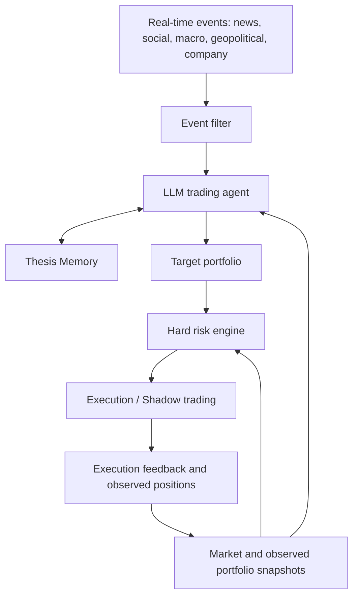

# EventLens

**Event → Thesis Memory → Position**

A foundation for a stateful, real-time event-driven trading agent powered by existing frontier LLM APIs. EventLens maintains persistent trading theses about ongoing situations, revises them as evidence changes, and expresses decisions as a target portfolio subject to deterministic risk limits.

**Status: official event intake, durable memory and chronological historical LLM research replay (v0.12).** SQLite stores event evidence, immutable thesis revisions and decision history. A Federal Reserve monetary-policy RSS watcher can discover new FOMC statements, validate source links, record publication/receipt times, and optionally send them to DeepSeek for thesis updates. Its first run baselines existing feed items without paid inference. Offline tests and manual real-source/API checks cover this path; CI makes no paid calls. DeepSeek uses the `deepseek-flash` API alias; serving metadata is retained when available (see [provider model table](https://api-docs.deepseek.com/quick_start/pricing/)). There is no general news/social feed, portfolio execution, risk implementation or trading broker adapter.

**Current research milestone:** EUR/USD × FOMC cost and timing checks. A small offline ledger tests fixed long/short/flat accounting with explicit stage delays, Bid/Ask spread, assumed commission/slippage and missing-data states. All eight predeclared 2025 Demo windows are now collected: **16,298 sampled snapshots**, held locally in about 122 KiB of compact gzip evidence. All 288 non-flat scenarios pass simulated fill-time and cash checks, but every thirty-minute path has sampling gaps and 60.79% of snapshots show zero spread. These cost/path limitations remain unresolved. Processing-time traces distinguish actual LLM processing from source-text age. This is not an LLM strategy backtest or evidence of profitability. See the [eight-event data quality report](docs/fomc-2025-data-quality.md), [research replay methods](docs/research-replay.md) and the [earlier three-event preview](docs/fomc-replay-preview.md).

**Cost/path follow-up:** the March 100 ms Demo replay reproduces all 2,009 original snapshots and records all 4,992 valid ticks delivered to the probe; a 9.845-second gap remains. Explicit spread-floor and minimum-commission safeguards now support five assumed floor levels across the eight original events. All 480 fixed-direction cases close, and higher floors never improve same-case net PnL. Demo symbol fee metadata and manually configured simulator fees are recorded separately; no charged fill fee is verified. See [cost/path evidence and acceptance](docs/cost-path-check.md).

**Position-proposal foundation:** a provider-neutral JSON schema links a proposed long/short/flat direction to exact thesis revisions and current-event evidence. A pinned manifest fixes EUR/USD, 1,000 EUR directional size, a five-minute signal-time horizon, and all assumed delay/cost sensitivities. Pure checks validate supplied context and always return `execution_authorized=false`. The v0.9 proposal stage makes no model calls and does not implement full hard risk or fills. The separate v0.10 context adapter below supplies an explicit historical input boundary. See [proposal contract and frozen rules](docs/decision-protocol.md).

**Historical context foundation (pure offline builder):** archived events and market captures retain their original clocks in an audit envelope. A separate model view uses explicitly assumed event/quote availability, reads only quotes and committed run-local thesis revisions available by the portfolio reasoning cutoff, and rejects missing/stale data. Future prices, outcome labels and archive capture clocks are excluded from that view. This offline stage makes no API calls, proposals or fills. See [historical context and timestamp acceptance](docs/historical-context.md).

**One-event research inference:** the historical model view now feeds two sequential API stages: evidence-linked thesis updates, then a long/short/flat proposal. Config/schema/prompt hashes are frozen first; actual processing includes retries, waits and validation. Failures and over-budget proposals remain non-actionable. A real January 2025 FOMC case explicitly returned flat in 7.951 seconds: it passed the predeclared slow budget but exceeded the primary 4.85-second budget. The first rejected prompt experiment is also retained. No risk approval, PnL, fills or broker connection occurred. See [inference contracts](docs/replay-inference.md) and [actual API acceptance](docs/llm-replay-case.md).

**Chronological research replay:** all eight predeclared 2025 FOMC episodes now have a frozen coordinator and separate SQLite call/result/revision registry. Completed events resume without rebilling; uncertain calls stop for review. A real two-event pause and six-event resume produced seven continuous thesis revisions and 16 requests. Only **3/8** portfolio replies passed current-event evidence validation, all flat; five failures remain visible. Processing averaged 7.443 seconds and all cases exceeded the primary budget. Coordinator/restart acceptance passed; model-output reliability and trading readiness did not. See [series contracts and recovery](docs/chronological-replay.md) and [complete acceptance evidence](docs/fomc-series-acceptance.md).

## The core idea

A new event is evidence in an ongoing story. It may support an existing thesis, contradict it, create a new one, or be irrelevant. The agent considers that evidence together with remembered theses, current market conditions and observed positions before proposing a new portfolio.

For example, an unconfirmed supply disruption might create a watch thesis with no position. A verified follow-up could strengthen the thesis and justify proposed exposure. A subsequent restoration of supply could invalidate it and lead to a proposed exit. These are illustrative reasoning transitions, not trading rules or performance claims.



## Responsibility boundaries

- **LLM trading agent:** interprets events, links evidence to theses, reasons about changing beliefs, and proposes portfolio decisions. It uses existing APIs such as GPT; no LLM training or RL is planned.
- **Thesis Memory:** a durable, versioned record of beliefs, supporting and contradicting evidence, invalidation conditions, review times and decision history. It is not just a chat transcript or a vector search index.
- **Target portfolio:** the desired signed exposure, distinct from current positions. Open, add, reduce, close, reverse and hedge are represented as changes in target exposure. Ignore/hold can leave the target unchanged.
- **Hard risk engine:** independent code that approves or rejects a proposal using operator-controlled limits and current account/market state. The LLM cannot edit limits or approve its own proposal.
- **Execution / shadow layer:** consumes only validated, current risk-approved targets. Recorded intentions are not fills; actual positions come from the shadow ledger or broker reconciliation.

This design intentionally lets the LLM reason about portfolio decisions. It does not require a separately trained return model between the agent and the risk gate. Those decisions will still need later research and shadow validation before any real execution.

## Repository structure

```text
eventlens/
├── README.md
├── pyproject.toml
├── configs/
│   ├── fomc-2025.json # Predeclared official events
│   ├── cost-sensitivity.json # Assumed spread floors, never verified fees
│   ├── decision-protocol-v1.json # Pinned rules and content hash
│   └── replay-inference-v1.json # Default request, timeout and retry settings
├── examples/
│   ├── synthetic-ctrader-ticks.json
│   ├── synthetic-ctrader-probe.log
│   ├── synthetic-research-window.json
│   ├── synthetic-position-proposal.json
│   ├── synthetic-historical-context.json
│   ├── synthetic-inference-case.json
│   ├── synthetic-series-plan.json
│   └── position-proposal.schema.json
├── ctrader/
│   └── EventLensTickProbe.cs # Backtesting-only, read-only Demo data check
├── docs/
│   ├── architecture.md
│   ├── memory.md
│   ├── reasoning.md
│   ├── fed-intake.md
│   ├── fomc-memory-case.md
│   ├── market-data.md
│   ├── fomc-replay-preview.md
│   ├── fomc-2025-data-quality.md
│   ├── research-replay.md
│   ├── cost-path-check.md
│   ├── decision-protocol.md
│   ├── historical-context.md
│   ├── replay-inference.md
│   ├── llm-replay-case.md
│   ├── chronological-replay.md
│   ├── fomc-series-acceptance.md
│   └── fomc-series-acceptance.json
├── scripts/
│   ├── audit_fomc_windows.py # Reproduce quality checks from local compact evidence
│   ├── audit_cost_path.py # Offline cost floors and one dense-path diagnostic
│   └── prepare_fomc_series.py # Public archive text plus local windows; no LLM/broker
├── notebooks/
│   ├── fomc-window-quality.ipynb # Executed aggregate audit; no raw quotes
│   └── cost-path-check.ipynb # Cost sensitivities and dense replay counters
├── src/eventlens/
│   ├── __init__.py
│   ├── contracts.py    # Events, theses, context, targets, risk and audit records
│   ├── events.py       # EventSource and EventFilter interfaces
│   ├── memory.py       # Durable ThesisMemory contract and revision conflicts
│   ├── sqlite_memory.py # Transactional SQLite implementation and history queries
│   ├── memory_cli.py    # Synthetic demo and inspection commands
│   ├── deepseek.py      # DeepSeek API adapter behind a JSON model interface
│   ├── reasoning.py     # Proposal validation and memory-only orchestration
│   ├── decision_protocol.py # Research proposal schema and pinned rules
│   ├── decision_cli.py   # Offline schema/export/context checks
│   ├── historical_context.py # Separate replay clocks and point-in-time input view
│   ├── replay_inference.py # Two-stage research inference and processing audit
│   ├── inference_cli.py # Offline plan or explicitly opt-in paid case
│   ├── series_replay.py # Chronological coordinator, transaction and paid-call journal
│   ├── series_cli.py # Offline plan, opt-in run/resume and read-only report
│   ├── latency.py       # Observed application processing traces
│   ├── fed.py           # Official FOMC RSS intake, validation and durable inbox
│   ├── fed_cli.py       # One-shot or continuous polling command
│   ├── market_data.py   # Side-specific historical ticks and as-of quotes
│   ├── ctrader_ticks.py # Pure Open API historical-tick decoder
│   ├── market_quality.py # Quote coverage and spread diagnostics
│   ├── market_cli.py    # Offline tick-page inspection
│   ├── replay_labels.py # Assumed-availability quote checkpoint labels
│   ├── replay_cli.py    # Offline Demo probe-log labeling
│   ├── research_data.py # Catalog, window provenance and compact data adapters
│   ├── research_replay.py # Fixed-position offline cost/timing accounting
│   ├── research_cli.py  # Independent accounting scenarios; no model/broker calls
│   ├── agent.py        # Provider-agnostic TradingAgent interface
│   ├── portfolio.py    # Observed state and target validation interfaces
│   ├── risk.py         # Deterministic HardRiskEngine interface
│   ├── execution.py    # Shadow-only execution interface
│   └── runtime.py      # Future orchestration and audit interfaces
├── tests/
│   ├── test_contracts.py
│   ├── test_memory.py
│   ├── test_reasoning.py
│   ├── test_fed.py
│   ├── test_market_data.py
│   ├── test_replay_labels.py
│   ├── test_research_replay.py
│   ├── test_window_audit.py
│   ├── test_cost_floors.py
│   ├── test_probe_diagnostics.py
│   ├── test_decision_protocol.py
│   ├── test_historical_context.py
│   ├── test_replay_inference.py
│   ├── test_series_replay.py
│   └── test_latency.py
└── .github/workflows/
    └── tests.yml
```

One Python package, clear module boundaries, no microservices. Pydantic and HTTPX are the runtime dependencies. The model client interface allows another API provider without changing memory storage.

## Thesis lifecycle

1. Persist the raw event. Semantic duplicate and source-authenticity filters are planned; this stage only rejects conflicting event IDs.
2. Load committed thesis memory, observed positions, pending orders and current market data.
3. Ask the agent for evidence-linked thesis revisions. This stage forbids target portfolios.
4. Validate the response and its references, then commit beliefs with optimistic concurrency checks.
5. If a target exists, validate it against current positions and independently evaluate hard risk.
6. Record approved shadow intent and subsequent execution feedback separately from beliefs.
7. Revisit active theses on new evidence and scheduled review, even if no position is held.

A rejected trade does not erase a valid thesis update. An agent failure does not create a default trade. Concurrent updates require a fresh decision; stale proposals are never blindly replayed.

## Run locally

From a fresh checkout, using Python 3.11+:

```bash
python3 -m venv .venv
source .venv/bin/activate
python -m pip install -e '.[dev]'
eventlens-memory demo
eventlens-memory history demo-supply
eventlens-memory event demo-event-2
eventlens-memory snapshot --as-of 2026-01-01T00:01:00Z
eventlens-fed --database data/fed.sqlite
eventlens-market examples/synthetic-ctrader-ticks.json
eventlens-replay examples/synthetic-ctrader-probe.log --event-id synthetic-fomc --source-time 2025-06-18T18:00:00Z
eventlens-research window examples/synthetic-research-window.json
eventlens-decision schema
eventlens-decision protocol
eventlens-decision check examples/synthetic-position-proposal.json
eventlens-decision replay-context examples/synthetic-historical-context.json
eventlens-infer plan examples/synthetic-inference-case.json
eventlens-series plan examples/synthetic-series-plan.json
pytest -q
ruff check .
mypy src
```

The memory demo uses a simulated January 1, 2026 clock and invented supply events. It creates `data/memory-demo.sqlite` locally. Repeating the demo is idempotent. Use a dedicated demo database, never a production memory store. No positions or orders are created by the memory demo. Add `--verbose` before the memory subcommand for logs. `--database PATH` selects another local SQLite file. Research commands run offline and print hypothetical accounting cases; output is saved only when explicitly requested. All runtime data remains outside Git. The architecture predating Thesis Memory remains accessible in Git history.

To try one real model call, create a **separate** local event JSON file matching `Event` in `contracts.py`, with a unique `event_id`, source URL/reference, actual source publication time, actual time received and source text. Use timezone-aware ISO 8601 timestamps. Then set `DEEPSEEK_API_KEY` in the shell that runs the CLI and call:

```bash
eventlens-memory --database data/research.sqlite reason path/to/event.json
eventlens-memory --database data/research.sqlite snapshot
```

Never put the key in JSON, a committed file or the command line. The `reason` command sends the event and current theses to DeepSeek and incurs API charges. Local event files remain manually supplied, unverified research input; the separate Fed watcher checks its official source allowlist. See [LLM reasoning and setup](docs/reasoning.md) for the exact contract and failure behavior.

The Fed watcher provides the first automatic source. Run `eventlens-fed --database data/fed.sqlite` once to baseline the current official feed without an API call, then repeat it to inspect newly collected raw events. To opt in to model reasoning, set `DEEPSEEK_API_KEY` and add `--reason`; `--watch --interval 60` keeps polling. On the Mac used for this project, the key can be read from Keychain without placing it in the command history:

```bash
DEEPSEEK_API_KEY="$(security find-generic-password -s eventlens-deepseek -a "$USER" -w)" eventlens-fed --database data/fed.sqlite --reason --watch --interval 60
```

See [Fed intake and acceptance](docs/fed-intake.md) for bootstrap, failure and timestamp semantics. Polling RSS is for research intake; it does not guarantee subsecond availability.

## Implementation boundaries

Implemented: immutable typed contracts, UTC validation, transactional SQLite memory, revision/expiry/evidence checks, historical snapshots, a provider-neutral JSON client interface, DeepSeek adapter, memory-only proposal validation, processing-time traces, official Fed polling adapter, durable collector inbox, CLIs and tests. The EUR/USD market-data path has an offline historical tick decoder, a read-only cTrader Demo replay probe and **indicative** checkpoint labels. The offline research ledger adds hypothetical fixed-position accounting and explicit gaps; it is separate from the future risk-approved shadow executor. The eight-event audit checks provenance, one-second bucket coverage, spreads and independent cash/fill invariants. Current real data supports endpoint checks, not continuous-path or strategy validation.

Defined but **not implemented**: semantic deduplication across different URLs/sources, independent fact-checking, non-Fed collectors, live portfolio reasoning/reconciliation, risk limits and shadow fills. Offline portfolio proposals and chronological catalog orchestration are implemented separately; automated realtime portfolio operation remains future work. No broker is hard-coded. No claims are made about event alpha, forecast accuracy or profitability.

An offline historical context adapter is also implemented; it constructs a separate allowlisted replay input rather than rewriting live event clocks. The separate research runner connects that view to model inference, without risk approval or fills.

The existing live-path memory CLI and Fed watcher stop at memory updates for review. The separate opt-in research CLI can also produce a validated historical direction proposal. See [memory storage and acceptance](docs/memory.md). The deterministic demo still uses predetermined decisions; the optional `reason` command invokes DeepSeek. All non-null portfolio targets remain rejected. There is no live trading path.

See [architecture and interface contracts](docs/architecture.md) for data semantics, concurrency, failure handling and future acceptance boundaries.

The [FOMC memory case study](docs/fomc-memory-case.md) records a two-event DeepSeek run against official September and November 2024 statements. It demonstrates one thesis created and later revised, with historical source times kept separate from the 2026 replay receipt times. It is not a return study or a backtest.
