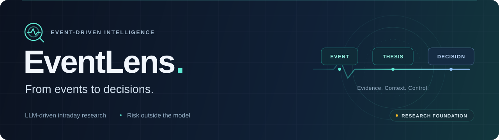
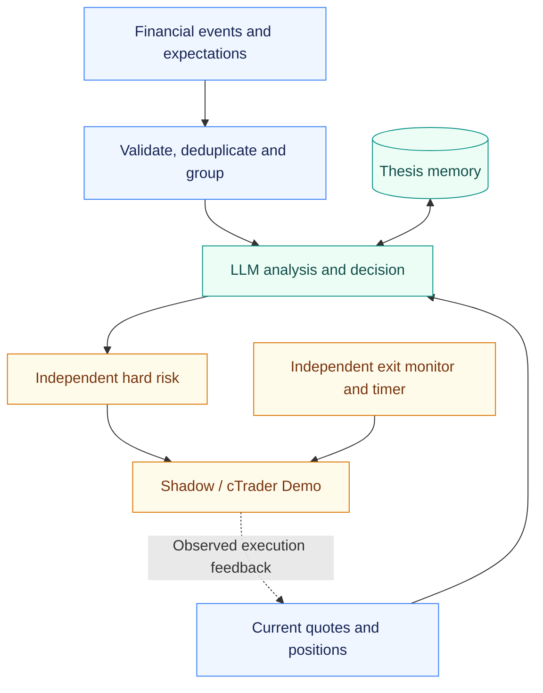

<p align="center">
  
</p>

<p align="center">
  <a href="https://github.com/lohis-aimbot/eventlens/actions/workflows/tests.yml"></a>
  <a href="pyproject.toml"></a>
  <a href="docs/roadmap.md"></a>
</p>

<p align="center">
  <strong>Financial events. Persistent context. Independent risk.</strong><br />
  A Python foundation for an LLM-driven intraday trading system.
</p>

<p align="center">
  <a href="#overview">Overview</a> ·
  <a href="#architecture">Architecture</a> ·
  <a href="#quickstart">Quickstart</a> ·
  <a href="#evidence">Evidence</a> ·
  <a href="#roadmap">Roadmap</a>
</p>

---

## Overview

EventLens explores how existing LLM APIs can interpret financial events, maintain a trading thesis and propose intraday position changes. Decisions would combine new information with market expectations, current prices, positions and relevant memory. The intended holding period is minutes to hours, with positions closed within the configured trading day.

> [!NOTE]
> **v0.13 · Research foundation.** Event intake, durable memory and historical research tools are implemented. Realtime portfolio decisions, hard risk, shadow execution and broker trading are not yet implemented. No profitability has been established.

<table>
  <tr>
    <td width="33%" valign="top"><strong>01 / Event</strong><br /><br />New information.<br />Clear evidence.</td>
    <td width="33%" valign="top"><strong>02 / Context</strong><br /><br />Relevant memory.<br />Revisable beliefs.</td>
    <td width="33%" valign="top"><strong>03 / Control</strong><br /><br />Bounded actions.<br />Independent risk.</td>
  </tr>
</table>

News categories remain open research questions: macro, policy, energy, geopolitical, company and later social events are candidates. Existing EUR/USD × FOMC experiments are a bounded case study, not the future system's news whitelist.

## Architecture

**Target workflow** — this is the intended design, not an implemented event-to-order loop.



One Python process and SQLite are sufficient initially. Analysis and decision can use one call or two isolated LLM roles; their reliability, latency and cost still need comparison. LLMs have no broker credentials and cannot override operator limits. Protective exits must operate without the model. No model training, RL, microservices or multi-agent framework is required.

**Design target: 30–60 seconds from first verified public release to the decision/order workflow under eligible conditions.** This is not a measured guarantee or a promise of fills. Original release, publisher display, receipt, analysis, order and fill times must remain distinct; unknown original release time stays unknown.

### What works today

| Layer | Implemented | Next capability |
|---|---|---|
| **Information** | Fed FOMC RSS polling, raw text, source/receipt clocks, durable inbox | General financial news and calendar adapters |
| **LLM & memory** | DeepSeek JSON adapter, validated thesis updates, immutable SQLite history | Reliable realtime decisions and bounded intraday context |
| **Market data** | Offline Bid/Ask decoding and Demo historical-data diagnostics | Live quotes and authoritative positions |
| **Research** | Historical input cutoffs, opt-in LLM replay, costs, delays and recovery | Integrated strategy evaluation and forward observation |
| **Trading** | Typed agent, portfolio, risk and execution interfaces | Hard risk, exits, shadow fills and cTrader Demo execution |

[Read the architecture and module map →](docs/architecture.md)

## Quickstart

**Python 3.11+** · Start with the offline tools. No API key is needed for these examples.

```bash
python3 -m venv .venv
source .venv/bin/activate
python -m pip install -e '.[dev]'

# Explore the command groups
eventlens --help

# Validate a synthetic proposal; execution remains disabled
eventlens research decision check examples/synthetic-position-proposal.json

# Inspect a frozen research plan without calling a model
eventlens research series plan examples/synthetic-series-plan.json
```

| Command group | Purpose |
|---|---|
| `eventlens memory …` | Memory inspection, synthetic demo and explicit memory reasoning |
| `eventlens source fed …` | Existing Fed polling collector; use `--help` to inspect options |
| `eventlens research …` | Historical data, accounting, proposal validation and opt-in inference |

The `check` and `plan` examples above are offline. Running the Fed collector accesses its public source; paid research inference requires credentials and explicit opt-in. There is no `observe` command yet. All eight older `eventlens-*` commands remain available.

<details>
<summary><strong>Model setup and existing command compatibility</strong></summary>

For model setup, see [memory reasoning](docs/reasoning.md) and [historical inference](docs/research/replay-inference.md). Never put credentials in chat, source files or Git.

Relocated Python modules use `eventlens.sources.*`, `eventlens.trading.*` and `eventlens.research.*`; old Python import paths are not aliases. Console commands and `python -m eventlens.<existing>_cli` remain compatible. Research config paths, database formats and frozen experiment content are unchanged.

</details>

## Evidence

The latest chronological study covers **eight historical FOMC episodes**. It tests integration, memory continuity and restart behavior, not trading performance.

| Observation | Result | Interpretation |
|---|---|---|
| Evidence-valid position proposals | **3 / 8**, all flat | Five replies were rejected; this is not forecast accuracy |
| Mean two-stage processing | **7.443 s** | Excludes realtime feed, order delivery and fills |
| Pause and resume | Completed without duplicate requests | Recovery evidence, not execution readiness |
| Market data and costs | Demo gaps, unresolved zero spreads, assumed fees/slippage | Insufficient for a validated profitability claim |

[Full acceptance report →](docs/research/fomc-series-acceptance.md) · [Market-data limitations →](docs/research/fomc-2025-data-quality.md)

## Roadmap

- [x] **Foundation** — typed contracts, durable evidence and thesis memory, model adapter.
- [x] **Historical tools** — time-aware replay, cost accounting and restart-safe experiments; model reliability remains insufficient.
- [x] **Repository organization** — separate source, research and trading modules; preserve existing commands and experiment identity.
- [ ] **Realtime observer** — collect broad financial events and quotes, then record structured decisions without orders.
- [ ] **Evaluation & protection** — realistic replay/shadow accounting, independent hard limits and daily exits.
- [ ] **cTrader Demo** — isolated execution adapter and reconciled positions after earlier gates pass.

The next milestone is observation, not automatic orders. News/provider selection remains open. Additional AI roles must demonstrate value against a simpler baseline.

[Stage objectives and acceptance criteria →](docs/roadmap.md)

## Repository

```text
eventlens/
├── src/eventlens/
│   ├── sources/         Event interfaces and Fed adapter
│   ├── research/        Historical data, replay and experiments
│   ├── trading/         Agent, portfolio, risk and execution interfaces
│   ├── contracts.py     Shared typed records and UTC validation
│   ├── deepseek.py      Replaceable JSON model boundary and adapter
│   ├── reasoning.py     Existing memory-only LLM path
│   ├── sqlite_memory.py Durable evidence and thesis history
│   ├── runtime.py       Future realtime coordinator interface
│   └── cli.py           Grouped access to existing commands
├── tests/               Shared, source and research checks
├── configs/             Pinned research configurations
├── docs/                Architecture, roadmap and research evidence
├── ctrader/             Read-only Demo backtesting probe
├── scripts/             Research utilities
├── notebooks/           Existing data-quality and cost diagnostics
├── examples/            Synthetic inputs and schema examples
└── data/                Local ignored evidence; not committed
```

<details>
<summary><strong>Development checks</strong></summary>

```bash
pytest -q
ruff check .
ruff format --check .
mypy src scripts
```

CI runs offline/synthetic checks on Python 3.11 and 3.12, without paid model or broker calls. Keep output validity, predictive quality and after-cost performance separate.

</details>

## Documentation

| Start here | Research and operations |
|---|---|
| [Architecture](docs/architecture.md) | [Research replay](docs/research/research-replay.md) |
| [Roadmap](docs/roadmap.md) | [Historical input boundaries](docs/research/historical-context.md) |
| [Thesis memory](docs/memory.md) | [Chronological replay and recovery](docs/research/chronological-replay.md) |
| [Fed intake](docs/fed-intake.md) | [Historical implementation snapshot](docs/research/implementation-history.md) |

---

<p align="center"><sub>EventLens · Evidence before exposure.</sub></p>
