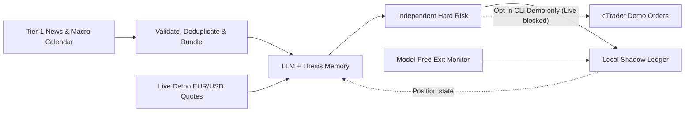

<p align="center">
  
</p>

<p align="center">
  <strong>English</strong> · <a href="README_CN.md">简体中文</a>
</p>

<p align="center">
  <a href="https://github.com/lohis-aimbot/eventlens/actions/workflows/tests.yml"></a>
</p>

<p align="center">
  <strong>Python 3.11+</strong> &nbsp;·&nbsp; <strong>377 Automated Tests</strong> &nbsp;·&nbsp; <strong>Shadow &amp; Opt-In Demo Mode</strong> &nbsp;·&nbsp; <strong>Demo-Only Locked</strong>
</p>

<p align="center">
  <a href="#overview">Overview</a> ·
  <a href="#how-it-works">How It Works</a> ·
  <a href="#capabilities">Capabilities</a> ·
  <a href="#quickstart">Quickstart</a> ·
  <a href="#cloud-operation">24×5 Cloud</a> ·
  <a href="#evidence">Evidence</a> ·
  <a href="#roadmap">Roadmap</a> ·
  <a href="#documentation">Docs</a>
</p>

---

## Overview

> [!IMPORTANT]
> **Operational checkpoint · November 11, 2026.** Automated Python verification passes **377 tests**, Ruff, and mypy, including `HistoricalTrade` `ClosingDealId` close-deal accounting, conservative cross-day `demo_daily_state` risk guards, and `UsdPerOneLot` / `UsdPerMillionUsdVolume` Razor commission metadata. On the Ubuntu 24.04 GCP VM, the final `EventLensCliBridge.algo` (`TargetFramework=net6.0`, locked `cTrader.Automate 1.0.21`, `BUILD_UID_GID=0:0`) compiled cleanly (`0 errors / 0 warnings`), passed disconnected `--network none --user 1654:1654` metadata inspection, completed read-only `demo-reconcile` (`clean: true`) and a bounded `1,000 EUR` Pepperstone Demo `demo-smoke` cycle (`passed: true`, SL attached, `ClosingDealId` verified, `flat_after_close: true`), and entered continuous `24×5` Demo evaluation. See the historical [cloud preflight audit](docs/research/2026-11-11-cloud-preflight-audit.md) and [cloud deployment runbook](docs/cloud-24x5-deployment.md) for exact boundaries.

**EventLens** is an intraday research system built around one core workflow: **Event → Thesis Memory → Position**.

When major macroeconomic news breaks, EventLens uses an off-the-shelf LLM API (`DeepSeek`) to read the release, update a persistent trading thesis in SQLite, and propose a bounded intraday **EUR/USD** position (typically held for minutes to hours and closed within the trading day).

Crucially, **the LLM never holds broker credentials and never has the final say**. Independent, deterministic Python rules check every proposal against position limits, quote freshness, spread quality, feed lag, and daily API cost caps—and run stop-loss, take-profit, and trailing exits even if the LLM is completely offline.

<table>
  <tr>
    <td width="25%" valign="top">
      <strong>01 · Observe</strong><br /><br />
      Capture Tier-1 macro wires and live Demo EUR/USD quotes while recording exact arrival clocks.
    </td>
    <td width="25%" valign="top">
      <strong>02 · Reason</strong><br /><br />
      Interpret surprises against consensus, revise durable thesis memory, and propose a target weight.
    </td>
    <td width="25%" valign="top">
      <strong>03 · Govern</strong><br /><br />
      Enforce hard risk limits, block stale data from adding risk, and monitor pip exits without the model.
    </td>
    <td width="25%" valign="top">
      <strong>04 · Record</strong><br /><br />
      Simulate fills, spreads, and commissions in a local Shadow ledger with every rejection preserved.
    </td>
  </tr>
</table>

> [!IMPORTANT]
> **Honest research boundary.** EventLens defaults to local Shadow simulation (`CTRADER_ALLOW_DEMO_ORDERS=false`), and CLI Demo order execution requires explicit opt-in (`--ctrader-cli-demo-orders --confirm-demo-execution`) on a verified `!Account.IsLive` Demo account. Passing bounded Demo operational smoke verifies end-to-end execution plumbing—**after-cost strategy profitability and multi-day unattended stability remain under forward evaluation, not proven**. Real-money Live accounts and legacy `--ctrader-demo-mirror-orders` remain physically blocked in code.

---

## How It Works

A single Python process and local SQLite databases power the current baseline loop—no custom LLM pretraining, microservices, or multi-agent frameworks are needed. Analysis and sizing currently run in one structured JSON call (comparing one-pass vs. isolated two-role LLM calls remains an open research item).



- **Target response window:** `30–60 seconds` from first verified public release to decision workflow under healthy conditions (a design target, not a guaranteed SLA).
- **Open scope:** Current live experiments focus on **EUR/USD** macro windows as a clean testbed; broader event categories (central bank policy, energy, geopolitics, equities, and social feeds) remain open research candidates.

---

## Capabilities

Every layer separates **what the AI thinks** from **what the system can verify**:

| Layer | What Works Today | Built-In Safeguards |
|---|---|---|
| **Information Intake** | Default **Tier-1 English stack** (`investingLive` live HTML streams + Q&A enrichment, official `ECB`, `Federal Reserve`, `US BEA`, and `Forex Factory` weekly calendar) plus legacy `WallStreetCN`; simultaneous multi-indicator release bundling (`--bundle-events`) | Separates `scheduled_at`, `original_published_at`, `publisher_display_at`, `modified_at`, `received_at`, and `available_at` (unknown release times stay unknown); flags `Consensus Forecast: MISSING` explicitly; evaluates 4D feed health (`http_transport`, `cache_observation`, `content_activity`, `verifiable_lag`) |
| **LLM & Thesis Memory** | `DeepSeek` structured JSON adapter; single-pass thesis updates + portfolio actions (`IGNORE_EVENT`, `HOLD`, `SET_TARGET`, `CLOSE`) with atomic thesis reversal and causal price trajectory context; optional **stateful thesis reviews** (`ReviewPolicy`) on `review_at`, periodic timers, breakout excursions, or structured price rules | Immutable SQLite thesis revisions (`sqlite_memory.py`); crash-safe `runtime_event_bundles` recovery without duplicate model calls; single-clause price triggers (`EUR/USD >= 1.1145`) strictly separated from non-executable natural language; review cooldowns and call caps (`runtime_reviews`) |
| **Quotes & Cost Policy** | Docker **`cTrader CLI` Demo bridge** (`EventLensCliBridge`, `12h` rotating streams) + headless Python **cTrader Open API Demo streamer** (`demo.ctraderapi.com:5036` over TLS/TCP) + local cTrader Desktop cBot bridge (`10–86400s`) + offline Bid/Ask tools; Razor commission metadata (`$30` per `$1M` USD volume via `UsdPerMillionUsdVolume` and `$3` per standard lot per side via `UsdPerOneLot`) | Base policy rejects zero spread; default `pepperstone_razor_200` allows `0.0 pip` spreads only for verified commission-bearing Demo sources (`--no-allow-commission-zero-spread` disables it); strictly separates `live_poll`, `synthetic_fixture`, and `historical_bar_replay` provenance |
| **Hard Risk & Exits** | `DeterministicTargetValidator` and `DeterministicHardRiskEngine` governing leverage, max weight, `q`-dependent ex-ante trade risk budgets, conservative cross-day `demo_daily_state` loss guards, quote-wait windows (`awaiting_market_quote` → `expired`), and `--max-daily-llm-calls` UTC budget caps | Stale or degraded feeds block opening/increasing risk while always permitting `CLOSE` and protective exits; pips-based stop-loss, take-profit, trailing stops, max-holding timers, entry cutoff guards, and two-phase shutdown drain run without the LLM |
| **Shadow & Demo Ledger** | Local `SQLiteShadowLedger` accounting + opt-in `CTraderCliDemoExecutionEngine` (`ClosingDealId`-verified fills and `position_closed_unpriced` guards); configurable simulation profiles (`pepperstone_razor_200` at `$200` / `200x` default; `--account-profile institutional_10k` at `$10,000` / `1x`); historical anti-lookahead replay (`scripts/run_historical_bar_replay.py`) | `shadow status` and `shadow report` open SQLite in strict read-only mode (`?mode=ro`) with bounded-anchor objective window diagnostics; results from different sizing profiles are never combined; live endpoints/accounts and `--ctrader-demo-mirror-orders` are hard-blocked |

---

## Quickstart

Requires **Python 3.11+**. The offline examples below run immediately with **no API keys**:

```bash
python3 -m venv .venv
source .venv/bin/activate
python -m pip install -e '.[dev]'

# Explore all CLI command groups
eventlens --help

# 1. Capture synthetic news/calendar events into an isolated offline demo DB
eventlens observe demo examples/synthetic-observer.json

# 2. Validate a sample position proposal through deterministic risk rules (no orders sent)
eventlens research decision check examples/synthetic-position-proposal.json

# 3. Inspect a frozen historical experiment plan without calling any LLM
eventlens research series plan examples/synthetic-series-plan.json
```

| Command Group | What It Does |
|---|---|
| `eventlens observe …` | Capture live Tier-1 English macro feeds (`capture`), view upcoming macro windows (`schedule`), and audit feed timing (`report`) |
| `eventlens shadow …` | Run or inspect the automated Shadow / opt-in CLI Demo loop (`start`, `stop`, `status`, `report`, `recover`, `demo-reconcile`, `demo-smoke`, `demo-unlock`) in bounded or `--continuous` mode |
| `eventlens memory …` | Inspect persistent thesis revisions, supporting evidence, and standalone memory reasoning |
| `eventlens source fed …` | Run the dedicated Federal Reserve polling collector |
| `eventlens research …` | Run historical cutoffs, anti-lookahead bar replays, cost-floor checks, and opt-in historical LLM inference |

<details>
<summary><strong>Inspect upcoming EUR/USD macro windows &amp; capture live Tier-1 feeds (no API key required)</strong></summary>

```bash
# Show upcoming high/medium EUR & USD releases in UTC and Beijing Time (with explicit MISSING consensus markers)
eventlens observe schedule --hours 36

# Poll one live snapshot across investingLive, ECB, Fed, US BEA, and Forex Factory
eventlens observe capture

# Inspect captured records, revisions, and 4D stream health offline
eventlens observe report
```

- Use `eventlens observe schedule --offline` to inspect schedules from an existing local observer database without internet access.
- All eight legacy `eventlens-*` console commands and `python -m eventlens.<module>_cli` entrypoints remain supported alongside `eventlens.{sources,trading,research}.*`. Never place API keys or tokens in chat, code, or Git.
</details>

---

## Cloud Operation

EventLens includes a headless Linux deployment bundle (`deploy/gcp/`) so continuous `24×5` operation on an `x86_64` Ubuntu 24.04 VM does not depend on keeping a local Mac/Windows cTrader desktop window open:

- **Primary Docker `cTrader CLI` bridge (`ctrader/EventLensCliBridge/` + `eventlens-ctrader-cli.service`):** Builds `EventLensCliBridge.algo` (`TargetFramework=net6.0`, required by `cTrader.Automate 1.0.21`) via Microsoft's pinned `.NET 8 SDK` container (`mcr.microsoft.com/dotnet/sdk@sha256:1b955f179b02df4f0eb5fadedaa898cbe44d620a64aab52eec72c8e91d1355b5`) and runs it inside Spotware's pinned console image (`ghcr.io/spotware/ctrader-console@sha256:6a339e15ee895de270be4a4e293fdb3f2fcdbecfbbace460105703125742e5ad`, `linux/amd64`, isolated from `DEEPSEEK_API_KEY`), streaming `12h`-rotated `EURUSD` Demo quotes (`quotes-<session>.jsonl`), session-scoped `(bridge_session_id, event_seq)` `reconcile_snapshot` events, and opt-in position-ID & `ClosingDealId`-verified Demo execution (`CTraderCliDemoExecutionEngine` + `CTraderCliDemoBrokerAdapter`, plus bounded `eventlens-shadow demo-smoke` and `demo-unlock`) behind `!Account.IsLive` + `DeterministicHardRiskEngine` approval.
- **Alternative native TLS/TCP Demo quote stream (`ctrader_openapi.py`):** Connects directly to `demo.ctraderapi.com:5036` for Demo quotes only (`CTraderLiveEndpointForbiddenError` + `CTraderLiveAccountForbiddenError`; legacy `--ctrader-demo-mirror-orders` remains blocked).
- **24×5 continuous safeguards:** `q`-dependent ex-ante risk-budget sizing (`--max-risk-per-trade-pct 0.02`), conservative cross-day `demo_daily_state` baseline guards across outages/restarts, FX weekend auto-pause (`America/New_York` Friday `17:00` → Sunday `17:00`, DST-aware), UTC daily LLM call caps (`--max-daily-llm-calls`), wall-clock deadline guards, and `SIGTERM` shutdown drain.
- **Current boundary:** On the Ubuntu 24.04 (`x86_64`) GCP VM, the final `EventLensCliBridge.algo` compiled cleanly with `BUILD_UID_GID=0:0` (`.algo` SHA-256 `24d5b3996d783ccafa91109e3b7d137993897eda86128ee3`), passed air-gapped `--network none --user 1654:1654` metadata inspection, completed Phase 1 read-only `demo-reconcile` (`clean: true`) and Phase 2 bounded `1,000 EUR` Pepperstone Demo `demo-smoke` (`passed: true`, SL attached, `ClosingDealId` verified, `flat_after_close: true`), and launched continuous `24×5` evaluation (`eventlens-ctrader-cli.service` + `eventlens-shadow-cli.service`). Arbitrary non-root build UIDs and non-root authenticated `ctrader-console` runtime are not accepted (container runs as upstream default root with setgid + ACLs on `/var/lib/eventlens/bridge`), and **multi-day unattended uptime and after-cost strategy profitability remain under forward evaluation**. See the historical [preflight audit](docs/research/2026-11-11-cloud-preflight-audit.md) and [runbook](docs/cloud-24x5-deployment.md).

```bash
# 1. Host provisioning & locked air-gapped-metadata .algo build on Ubuntu 24.04 (x86_64)
sudo bash deploy/gcp/setup_ubuntu.sh
sudo env BUILD_UID_GID=0:0 bash /opt/eventlens/deploy/gcp/build_ctrader_algo.sh

# 2. Read-only Demo reconcile (Phase 1) and opt-in bounded 1,000 EUR smoke check (Phase 2)
sudo -u eventlens /opt/eventlens/.venv/bin/eventlens-shadow demo-reconcile --ctrader-cli-bridge-dir /var/lib/eventlens/bridge
# See docs/cloud-24x5-deployment.md Section 5 for Phase 2 demo-smoke and 24×5 systemd operation.
```

Full cloud setup & Demo acceptance runbook → **[docs/cloud-24x5-deployment.md](docs/cloud-24x5-deployment.md)**

---

## Evidence

EventLens keeps a clear line between **automated offline tests**, **recorded live Shadow runs**, **quarantined historical replays**, and **unproven goals**:

| Record | What Was Observed | What It Means (and Its Limits) |
|---|---|---|
| **Cloud CLI Demo smoke & 377-test suite · Nov 11, 2026** | Final `EventLensCliBridge.algo` (`net6.0`, `cTrader.Automate 1.0.21`) compiled (`0 errors / 0 warnings`) and passed air-gapped metadata check; **377 Python tests**, Ruff, and mypy passed; Pepperstone Demo `demo-reconcile` (`clean: true`) and bounded `1,000 EUR` `demo-smoke` (`passed: true`, SL attached, `HistoricalTrade.ClosingDealId` verified, `flat_after_close: true`) completed ahead of `24×5` launch | Verifies end-to-end headless CLI Demo execution, Razor `UsdPerOneLot` zero-spread commission gating, and causal close-deal reconciliation—does **not** establish multi-day uptime or strategy alpha |
| **Cloud preflight · Nov 11, 2026** | Private Ubuntu VM verified; initial `.algo` compilation and disconnected metadata inspection passed for the [recorded preflight snapshot](docs/research/2026-11-11-cloud-preflight-audit.md); `373` Python tests passed prior to final close-deal and `UsdPerOneLot` fixes | Preserved preflight baseline documenting container digests, `BUILD_UID_GID=0:0` requirement, and pre-launch audit findings |
| **Offline test suite · Nov 11, 2026** | **377 passing tests** (`pytest`, `ruff`, `mypy` on Python 3.11/3.12) | Verifies state machines, risk gates, `UsdPerOneLot` & `UsdPerMillionUsdVolume` Razor metadata, snapshot-vs-`order_event` close race guards, `ClosingDealId` deal accounting, cross-day `demo_daily_state` guards, and live-account blocking |
| **Live Shadow · Oct 23, 2026** | **1,786 Demo quotes**, 6 LLM cycles, 5 memory versions, **2 Shadow entries** (`4.974 s` and `14.151 s` receipt-to-fill), 1 timed exit | First live EUR/USD France/Germany Flash PMI runs; predates two-phase drain (~5-minute gap occurred between the two sessions while a position was open) |
| **Live Recovery & Continuous Window · Oct 27, 2026** | Both Oct 23 residual positions closed on fresh live quotes (`unclosed_risk = false`), followed by a **2,240.0 s uninterrupted session** (`3,517` valid quotes, `0` rejected, **10,761 protection checks**, `84` events persisted: `77` filtered, `5` `IGNORE_EVENT`, `2` stale-quote rejections) | Verified live crash recovery without historical price backfilling, zero protection blind spots while holding risk, honest retention of ignored events, and clean `flat_completed` drain |
| **Live Failure Audit · Oct 29, 2026** | Observed `investingLive` RSS CloudFront `Age: 313s` lag and a mid-session local quote-bridge outage during the ECB window | Proved that HTTP `200` does not guarantee fresh news (motivating the switch to live HTML streams and 4D source health gating) |
| **Historical FOMC Study** | **8 chronological episodes**; `3/8` valid proposals (all flat); `7.443 s` mean two-stage latency; `3.854 s` single-pass smoke check | Verified memory continuity, schema validation, and pause/resume safety—not forecast accuracy or trading alpha |

### Epistemic Status Summary

| Status | Scope Today |
|---|---|
| **Implemented (`已实现`)** | Tier-1 English intake, `MacroSemantics` & delayed-catchup guards, `single-pass-agent-v3.1` evidence verification, `q`-dependent ex-ante risk-budget sizing, Docker `cTrader CLI` bridge (`EventLensCliBridge`) + `CTraderCliDemoExecutionEngine` / `CTraderCliDemoBrokerAdapter`, native Open API quote streamer, and `status`/`report`/`demo-reconcile`/`demo-smoke`/`demo-unlock` CLIs |
| **Offline-Verified (`离线验证`)** | **377 passing tests** (`pytest`, `ruff`, and `mypy`) covering the Nov 4 overnight fault sequence, `12h` bridge rotation (`>4` files), wall-clock expiry, `UsdPerOneLot` Razor commission metadata, causal snapshot-vs-`order_event` close reconciliation, `ClosingDealId` deal accounting, conservative cross-day `demo_daily_state` guards, `(bridge_session_id, event_seq)` restarts, UTC intent TTL, partial-line/outbox/`unknown_execution` safety, and live-account blocks |
| **Live-Observed (`真实观测`)** | Nov 11, 2026 Ubuntu 24.04 GCP `EventLensCliBridge` Pepperstone Demo `demo-reconcile` (`clean: true`), bounded `1,000 EUR` `demo-smoke` (`passed: true`), and active `24×5` cloud observation; plus Oct 22–Nov 6, 2026 local SQLite/JSONL captures preserved unmodified under gitignored `data/` ([acceptance report](docs/shadow-acceptance.md); [Nov 4 overnight audit](docs/research/overnight-20261104-shadow-audit-and-prompt-draft.md)). The ad-hoc Oct 28 1-minute Yahoo bar replay is [explicitly quarantined](docs/replay-errata-2026-10-28.md) as bar-level analysis only |
| **Pending Acceptance (`待验收`)** | Multi-day unattended `24×5` cloud forward window, cross-weekend reconnect observation, non-root authenticated `ctrader-console` runtime (currently upstream default root), and multi-window after-cost strategy evaluation |
| **Unavailable (`已阻断`)** | Real-money Live trading (`!Account.IsLive` / `LiveAccountForbiddenError`) and legacy Open API delta mirroring (`--ctrader-demo-mirror-orders`) |

---

## Roadmap

- [x] **Foundation** — Typed contracts, immutable SQLite evidence & thesis memory, and JSON model adapter.
- [x] **Historical Tools** — Strict `as_of` anti-lookahead replay, cost accounting, and restart-safe experiments.
- [x] **Modular Architecture** — Clean separation across `sources/`, `trading/`, and `research/` with backward-compatible CLIs.
- [ ] **Realtime Observer** — Multi-source capture, Razor commission provenance, and headless Demo quote streaming implemented; multi-day forward observation in progress.
- [ ] **Shadow Loop & Protection** — Hard risk, pips SL/TP/trailing exits, live recovery, and a `2,240 s` continuous window recorded; broader multi-session cycle coverage in progress.
- [ ] **cTrader Demo Execution** — Opt-in Docker `cTrader CLI` `positionId` & `ClosingDealId` execution and bounded Cloud `demo-smoke` verified; multi-day forward window pending.

**Next acceptance gate:** sustain uninterrupted quotes and independent protection across multi-day cloud sessions, document every exit or explicit handoff, and retain every ignored, rejected, and failed event alongside executed Shadow decisions.

### Long-Horizon Research Agenda

Future extensions form a tight three-part loop—**hard-risk safety floor → high-fidelity market simulator → RL execution & exit refinement**—and must beat simpler deterministic baselines before adoption:

| Research Pillar | Priority & Stage | Plain-Language Goal |
|---|---|---|
| **Neuro-Symbolic Governance & Formal Safety** | **Active foundation** | Keep LLM macro reasoning strictly separated from deterministic Python risk guards, using stateful property testing (`Hypothesis`) and formal verification (`Z3`) to prove safety across quote outages, rollovers, and shutdown drains |
| **Conditional Generative Market World Model** | **Core research focus** | Build an offline "flight simulator" for macro releases—generating realistic post-event price jumps, spread spikes, and whipsaw liquidity droughts—to solve macro sample scarcity and stress-test sizing/exit rules |
| **World-Model RL Execution & Exits (`FinRL`)** | **Paired frontier** | Keep macro direction with the LLM while training `FinRL` reinforcement learning agents (`PPO` / `SAC`) inside the Market World Model to optimize staged entries, dynamic trailing stops, and time-decay exits—strictly bounded by hard risk and walk-forward checks |

---

## Documentation

| Guide | What You Will Find |
|---|---|
| **[Architecture & Module Map](docs/architecture.md)** | Data contracts, runtime state machines, and risk governance boundaries |
| **[Continuous Cloud Deployment](docs/cloud-24x5-deployment.md)** | Ubuntu 24.04 `systemd` + Docker `cTrader CLI` Demo bridge, `demo-reconcile`/`demo-smoke`, weekend sleep, and daily caps |
| **[Observer & Feed Timing](docs/observer.md)** | Source collection, publication vs. arrival timestamps, and 4D stream health ([acceptance](docs/observer-acceptance.md)) |
| **[Live Quotes & Cost Policy](docs/live-quotes.md)** | Bid/Ask freshness, Razor zero-spread commission policy, and alignment ([acceptance](docs/live-quotes-acceptance.md)) |
| **[Memory & Reasoning](docs/memory.md)** | Thesis lifecycle, revision rules, and [LLM reasoning setup](docs/reasoning.md) |
| **[Shadow Acceptance Report](docs/shadow-acceptance.md)** | Complete October 2026 live Shadow records, recovery logs, and [Oct 28 replay errata](docs/replay-errata-2026-10-28.md) |
| **[Historical Research](docs/research/fomc-series-acceptance.md)** | 8-episode FOMC study, [market-data limits](docs/research/fomc-2025-data-quality.md), and [replay inference](docs/research/replay-inference.md) |
| **[Roadmap](docs/roadmap.md)** | Stage-by-stage acceptance criteria and research milestones |
| **[Visual Web Overview](docs/index.html)** | Standalone bilingual (`中文 / EN`) HTML product overview for local browser preview |

<details>
<summary><strong>Repository structure &amp; developer checks</strong></summary>

```text
eventlens/
├── src/eventlens/
│   ├── ctrader_openapi.py  Headless TLS/TCP cTrader Open API Demo quote streamer (execution blocked)
│   ├── runtime.py          Intraday event runtime, stateful thesis reviews & continuous ShadowRunner
│   ├── shadow_cli.py       Shadow & Demo CLI (start / stop / status / report / recover / demo-*)
│   ├── observer.py         Immutable feed captures, revisions, enrichments & 4D stream health
│   ├── quotes.py           QuoteStore, causal as-of alignment & Razor commission policy
│   ├── sqlite_memory.py    Durable SQLite thesis memory & revision history
│   ├── deepseek.py         Replaceable structured JSON LLM adapter
│   ├── contracts.py        Typed Pydantic contracts & UTC clock validation
│   ├── sources/            Tier-1 English, Fed, cTrader Demo & WallStreetCN adapters
│   ├── trading/            SinglePassTradingAgent, sizing, hard risk, Shadow & CLI Demo broker
│   └── research/           Anti-lookahead historical replay, cost floors & series runner
├── deploy/gcp/             Ubuntu 24.04 provisioning, Docker cTrader CLI compose & systemd units
├── ctrader/                EventLensCliBridge (net6.0 Docker cBot) & Desktop quote bridges
├── configs/                Pinned research & replay assumption manifests
├── scripts/                Historical bar replay & FOMC window audit scripts
├── notebooks/              Data-quality & cost-path diagnostic notebooks
├── examples/               Offline synthetic inputs & JSON schemas
├── docs/                   Technical guides, acceptance reports & pure-vector brand assets
├── tests/                  377 unit, integration & protocol tests
└── data/                   Local gitignored runtime SQLite databases (never committed)
```

```bash
pytest -q
ruff check .
ruff format --check .
mypy src scripts
```
</details>
