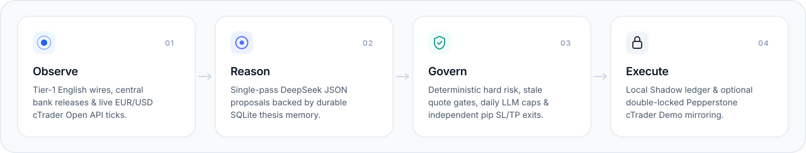

<p align="center">
  
</p>

<p align="center">
  <a href="https://github.com/lohis-aimbot/eventlens/actions/workflows/tests.yml"></a>
  <a href="pyproject.toml"></a>
  <a href="tests/"></a>
  <a href="docs/cloud-24x5-deployment.md"></a>
</p>

<p align="center">
  An event-driven Python system that translates macro releases into auditable intraday <strong>EUR/USD</strong> decisions.<br />
  Powered by persistent thesis memory, deterministic hard risk, and a 24×5 headless Demo runtime.
</p>

<p align="center">
  <a href="#overview">Overview</a> ·
  <a href="#architecture">Architecture</a> ·
  <a href="#quickstart">Quickstart</a> ·
  <a href="#cloud-24x5">Cloud 24×5</a> ·
  <a href="#evidence">Evidence</a> ·
  <a href="#documentation">Docs</a>
</p>

---

## Overview

EventLens separates **semantic interpretation** from **capital protection**:

1. **Interpret** — An LLM (`DeepSeek` JSON adapter) reads Tier-1 macro wires and central bank releases, updates durable SQLite thesis memory, and proposes bounded target weights (`IGNORE_EVENT`, `HOLD`, `SET_TARGET`, `CLOSE`).
2. **Govern** — Deterministic Python rules validate every proposal, block stale or degraded feeds from adding risk, cap daily model calls, and enforce pips-based stop-loss, take-profit, and trailing exits without needing the LLM.
3. **Audit** — Every raw event, arrival clock, quote tick, rejected proposal, and simulated fill is recorded locally in SQLite. Live broker accounts are hard-blocked in code.

> [!NOTE]
> **Research & Demo boundary.** EventLens is an intraday Shadow and Demo research system, not a live money-printing bot. Live forward profitability has not been established, and both endpoint and pre-auth account locks strictly forbid connecting to any `isLive=True` trading account.

---

## Architecture

<p align="center">
  
</p>

| Layer | Core Capability | Safety & Audit Invariant |
|---|---|---|
| **01 · Observe** | Tier-1 English wires (`investingLive`, `ECB`, `Fed`, `US BEA`, `Forex Factory`) + simultaneous release bundling | Separates `scheduled_at`, `published_at`, and `received_at`; flags `Consensus: MISSING` explicitly |
| **02 · Quotes** | Headless Python `cTrader Open API` TLS/TCP Demo streamer (`demo.ctraderapi.com:5036`) & local cBot bridge | Preserves raw Bid/Ask, Razor commission metadata, and sub-second freshness windows |
| **03 · Reason** | Single-pass thesis & portfolio proposals + bounded stateful thesis reviews (`ReviewPolicy`) | Immutable SQLite thesis revisions; durable bundle crash recovery without duplicate LLM calls |
| **04 · Govern** | `DeterministicHardRiskEngine`, stale-source risk gate, and `--max-daily-llm-calls` cost circuit breaker | Protective exits (`SL` / `TP` / trailing / max-hold) execute independently of LLM availability |
| **05 · Execute** | Local `SQLiteShadowLedger` accounting + optional `--ctrader-demo-mirror-orders` paper mirroring | Double Demo-only lock (`CTraderLiveEndpointForbiddenError` + `CTraderLiveAccountForbiddenError`) |

---

## Quickstart

Requires **Python 3.11+**. Offline commands run immediately with zero API keys.

```bash
python3 -m venv .venv
source .venv/bin/activate
python -m pip install -e '.[dev]'

# 1. View upcoming EUR & USD high-impact macro windows (UTC + Beijing Time)
eventlens observe schedule --hours 36

# 2. Run an offline synthetic capture and validate a sample decision proposal
eventlens observe demo examples/synthetic-observer.json
eventlens research decision check examples/synthetic-position-proposal.json
```

| Command | Purpose |
|---|---|
| `eventlens observe …` | Live Tier-1 English macro capture (`capture`), release calendar (`schedule`), and timing reports |
| `eventlens shadow …` | Intraday Shadow loop (`start`, `stop`, `status`, `report`, `recover`) in bounded or `--continuous` mode |
| `eventlens memory …` | Inspect durable thesis memory, revisions, and supporting evidence |
| `eventlens research …` | Historical cutoffs, anti-lookahead bar replay, cost floors, and series evaluation |

<details>
<summary><strong>Capture live Tier-1 macro feeds locally (no API key required)</strong></summary>

```bash
# Poll one live snapshot across investingLive, ECB, Fed, US BEA, and Forex Factory
eventlens observe capture

# Inspect captured records, source health, and latency taxonomy offline
eventlens observe report
```
</details>

---

## Cloud 24×5

EventLens runs **24×5 unattended on Linux** (`Ubuntu 24.04` + `systemd`) without requiring a desktop GUI or daily manual cBot restarts:

- **Zero extra dependencies**: Speaks Spotware's 4-byte length-prefixed TLS/TCP JSON protocol natively via Python `asyncio` + `ssl`.
- **Automatic token & session lifecycle**: Rotates `QuoteStore` sessions every `12h` and persists refreshed OAuth2 tokens atomically (`chmod 0600`).
- **Weekend auto-sleep**: Pauses news polling during FX market closure (`America/New_York` Fri `17:00` → Sun `17:00`, DST-aware).
- **Graceful `SIGTERM` drain**: Flattens or hands off open Shadow positions cleanly on `systemctl stop` / `restart`.

```bash
# Provision Ubuntu 24.04 VM (e.g. GCP e2-small) and install systemd unit
sudo bash deploy/gcp/setup_ubuntu.sh
sudo nano /etc/eventlens/eventlens.env   # Fill DeepSeek & cTrader Demo credentials (mode 0600)
sudo systemctl enable --now eventlens-shadow
```

Full setup & operations guide → **[docs/cloud-24x5-deployment.md](docs/cloud-24x5-deployment.md)**

---

## Evidence

EventLens tracks four distinct verification tiers so simulated checks are never confused with live performance:

| Milestone | Recorded Result | Scope & Meaning |
|---|---|---|
| **Offline test suite** | **355 passing tests** (`pytest`, `ruff`, `mypy`) | Deterministic verification of risk gates, Open API framing, crash recovery, and ledger math |
| **Live Shadow · Oct 23, 2026** | **1,786 live quotes**, 6 LLM cycles, 2 Shadow entries | First live EUR/USD Flash PMI observation (`4.97s` / `14.15s` receipt-to-shadow-fill) |
| **Live Shadow · Oct 27, 2026** | **2,240 s continuous window**, `10,761` protection checks | Verified clean residual recovery, `3,517` accepted Razor quotes, and `flat_completed` drain |
| **Chronological FOMC study** | **8 historical episodes** replayed end-to-end | Verified memory continuity, schema validation (`3/8` valid flat), and pause/resume safety |

| Epistemic Tier | Current Status |
|---|---|
| **Implemented (`已实现`)** | Tier-1 English intake, headless `cTrader Open API` Demo streamer, 24×5 runner, stateful thesis reviews, daily LLM budget cap, and strictly read-only `status`/`report` diagnostics |
| **Offline-Verified (`离线验证`)** | `355` automated tests across Python 3.11/3.12 covering protocol framing, live-account hard locks, weekend pause, stale-quote fail-closed gates, and bar-replay provenance |
| **Live-Observed (`真实观测`)** | Oct 22–29, 2026 local SQLite captures preserved unmodified under gitignored `data/` (separate Oct 28 1-minute Yahoo bar replay quarantined in [errata](docs/replay-errata-2026-10-28.md)) |
| **Pending Acceptance (`待验收`)** | Multi-day unattended 24×5 cloud forward run, live `investingLive` HTML forward latency audit, and after-cost strategy evaluation |

---

## Documentation

- **[Architecture & Module Map](docs/architecture.md)** — Contracts, data flow, and Neuro-Symbolic risk separation
- **[Cloud 24×5 Deployment](docs/cloud-24x5-deployment.md)** — GCP Ubuntu `systemd` setup and `cTrader Open API` Demo guide
- **[Observer & Feed Timing](docs/observer.md)** — Timestamp taxonomy and 4-dimensional stream health
- **[Live Quotes & Cost Policy](docs/live-quotes.md)** — Razor zero-spread commission provenance and freshness rules
- **[Shadow Acceptance Report](docs/shadow-acceptance.md)** — Detailed October 2026 live observation records and limits
- **[Roadmap & Research Agenda](docs/roadmap.md)** — Acceptance gates and long-horizon research pillars
- **[Web Overview (`docs/index.html`)](docs/index.html)** — Standalone bilingual (`中文 / EN`) visual product page

<details>
<summary><strong>Repository layout &amp; developer checks</strong></summary>

```text
eventlens/
├── src/eventlens/
│   ├── ctrader_openapi.py  Headless TLS/TCP cTrader Open API Demo streamer & order mirror
│   ├── runtime.py          Intraday event runtime, stateful reviews, 24x5 ShadowRunner
│   ├── shadow_cli.py       Shadow CLI (start / stop / status / report / recover)
│   ├── observer.py         Immutable feed capture, revisions & 4D stream health
│   ├── quotes.py           QuoteStore, as-of alignment & Razor commission policy
│   ├── sqlite_memory.py    Durable thesis memory & revision history
│   ├── sources/            Tier-1 English, Fed, cTrader Demo & WallStreetCN adapters
│   ├── trading/            SinglePassTradingAgent, hard risk & Shadow ledger
│   └── research/           Anti-lookahead historical replay & cost diagnostics
├── deploy/gcp/             Turnkey Ubuntu 24.04 setup script, env template & systemd unit
├── docs/                   Technical documentation, SVG brand assets & web overview
├── configs/                Frozen research & replay assumption manifests
└── tests/                  355 unit, integration & protocol tests
```

```bash
pytest -q
ruff check .
ruff format --check .
mypy src scripts
```
</details>
