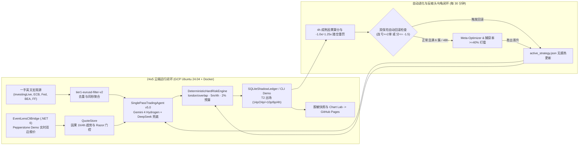

<p align="center">
  
</p>

<p align="center">
  <a href="https://github.com/lohis-aimbot/eventlens/actions/workflows/tests.yml"></a>
  
  
  <a href="https://lohis-aimbot.github.io/eventlens/dashboard/"></a>
  <a href="https://colab.research.google.com/github/lohis-aimbot/eventlens/blob/main/notebooks/stage_a_quant_reward_lab.ipynb"></a>
  
  
</p>

<p align="center">
  <a href="README.md">English</a> | <strong>简体中文</strong> &nbsp;·&nbsp;
  <a href="https://lohis-aimbot.github.io/eventlens/dashboard/"><strong>在线实时看板 ↗</strong></a> &nbsp;·&nbsp;
  <a href="docs/blueprint-v2_CN.md">研究蓝图 v2</a> &nbsp;·&nbsp;
  <a href="https://lohis-aimbot.github.io/eventlens/">项目可视化概览 ↗</a>
</p>

<p align="center">
  <a href="#1-项目简介">项目简介</a> ·
  <a href="#2-系统架构与安全边界">系统架构</a> ·
  <a href="#3-实测评估与法医复盘">实测评估</a> ·
  <a href="#4-下一阶段研究蓝图-v2">研究蓝图 v2</a> ·
  <a href="#5-在线双语实时看板">实时看板</a> ·
  <a href="#6-快速上手与复现验证">快速上手</a> ·
  <a href="#7-仓库结构与文档索引">仓库索引</a>
</p>

---

## 最新进展与研究日志

- **`[2026/11/27]`** 上线 **Auto-Evolution 自动进化与反缩头乌龟奖惩引擎**（`src/eventlens/evolution.py`、`eventlens-shadow evolve-tick`、`eventlens-evolution.timer`）：每 `30 分钟` 对走完 `4 小时` 观察窗的事件做因果结算与严格踏空扣分（`alpha_miss = 1.0x`，漏 `T3 >= 25p` 大单边按 `1.25x` 重罚，躺平奖励压缩至 `+0.05`），设 `>= 40%` 合格机会捕获率一票否决；每满 `6` 个成熟簇或 `48` 小时自动生成候选策略并打擂晋升，无感热更新 `active_strategy.json`；配置**防乱亏 + 防装死双保险自动回滚**（实盘连亏 `2` 单 / `-2.0R` **或** 含踏空奖励总分 `<= -1.5` 立即退回上一稳态版并拉黑废案），并在 Web 看板实时展示进化考评台（`docs/dashboard/index.html`）。
- **`[2026/11/26]`** 正式上线 **Strategy v5**（`single-pass-agent-v5.0`）：新增 `GeminiClient`（`gemini-4-hydrogen`, `thinkingLevel="low"`）主用 + `DeepSeekClient` 自动故障切换（`src/eventlens/gemini.py`）、`london/overlap` 流动性时段门控、因果 `1h/4h` 趋势与 `5m` 防追高硬风控、`T2_mid_swing` 保护（`14p SL / 24p TP / +10p->6p 移动锁盈 / 4h`）、修复 `"market-state-watch"` 复盘按纽约交易日重置并切换纯事件驱动唤醒。已在云端 `eventlens-demo-01` 实网验收后解除 `--kill-switch`，恢复受控 Demo 实测。
- **`[2026/11/25]`** 按照 **[总指挥研究与工程蓝图 v2](docs/blueprint-v2_CN.md)**（[English](docs/blueprint-v2.md)）正式上线 **Stage A 三大工程交付物**：只读云端导出管线 `eventlens-shadow export-research`（`src/eventlens/research_lab.py`）、Web 看板第 3 个主 Tab **`Chart Lab（K 线标注台）`**，以及一键同步云端 14+ 天数据的 **[Google Colab 量化与 Reward 实验室](https://colab.research.google.com/github/lohis-aimbot/eventlens/blob/main/notebooks/stage_a_quant_reward_lab.ipynb)**。
- **`[2026/11/24]`** 完成 11 月 11–24 日 Pepperstone Demo 真实前向运行法医复盘（`6` 笔交易，`0` 胜 `6` 负，`-11.62 USD`）。已在 GCP 云主机开启 `--kill-switch` 物理阻断新开仓，同时保持 `24×5` 报价与宏观新闻不间断采集沉淀。
- **`[2026/11/19]`** 上线 `single-pass-agent-v4.1`、`tier1-eurusd-filter-v2`（日均大模型调用从 `80 次/天` 降噪至 `~24–27 次/天`）、收紧 `8.0p/6.0p` 移动锁盈、纽约收盘前禁入保护及主界面直达开仓/CoT 推理链的 Web 看板改版。
- **`[2026/11/11]`** 在 Ubuntu 24.04 云端完成 `.NET 6` 无头桥接 `EventLensCliBridge.algo`（`cTrader.Automate 1.0.21`）编译与断网元数据检查，通过 `demo-reconcile` 与 `1,000 EUR` 有界 `demo-smoke`，启动 `24×5` 连续观测。

---

## 1. 项目简介

**EventLens** 是一个围绕 **EUR/USD（欧元/美元）** 构建的神经符号（Neuro-Symbolic）日内宏观事件研究与决策系统，核心链路简洁透明：

> **精确到达时钟宏观事件 → 持久化观点记忆 → 确定性硬风控把关 → 影子 / 隔离 Demo 执行**

与将大模型当作无约束交易黑盒的做法不同，EventLens 在代码结构上强制隔离 **“语义理解”** 与 **“交易权限 / 资金风控”**：

- **密钥物理隔离：** 大模型（`Gemini 4 Hydrogen` 主引擎 + `DeepSeek` 自动故障切换兜底）仅接收结构化上下文并输出受 Schema 约束的 JSON 提案，永远接触不到券商凭证与下单接口。
- **确定性风控与无模型出场：** 纯 Python 确定性引擎（`DeterministicHardRiskEngine`）独立负责 `london/overlap` 时段门控、`5m` 反追高与 `4h` 逆势硬拦截、单笔 `2%` 风险预算、`8 USD` 日亏熔断、`--kill-switch` 以及完全脱离模型的 `T2_mid_swing` 点数止损/止盈/移动锁盈/超时平仓。
- **严格防前视偏差时钟：** 每条 Tier-1 快讯与盘口报价都在 SQLite 中严格分离 `source_at`、`published_at`、`received_at` 与 `available_at` UTC 时间戳，杜绝回放与评估中的未来信息泄露。
- **反缩头乌龟自动进化：** 云端按 `1.0x–1.25x` 全额倒扣惩罚可交易时段踏空事件，每 `6` 个成熟簇或 `48` 小时自动打擂寻优（捕获率 `< 40%` 直接淘汰），并配备“连亏 2 单或奖励分 `<= -1.5` 立即自动回滚”的双保险机制。

---

## 2. 系统架构与安全边界



### 核心模块与安全机制

| 系统层级 | 核心源码模块 | 已实现功能与硬性防护 |
|---|---|---|
| **信息采集层** | `src/eventlens/sources/english_tier1.py`、`src/eventlens/observer.py`、`src/eventlens/latency.py` | 持续采集一手英文宏观快讯；`tier1-eurusd-filter-v2` 过滤综述、期权到期与非 G2 噪声；监测 4 维流健康度并严守到达时钟，不伪造缺失发布时间 |
| **LLM 与容灾记忆** | `src/eventlens/gemini.py`、`src/eventlens/deepseek.py`、`src/eventlens/trading/agent.py`、`src/eventlens/memory.py`、`src/eventlens/sqlite_memory.py` | 运行 `GeminiClient`（`gemini-4-hydrogen`, `thinkingLevel="low"`）主引擎与 `DeepSeekClient` 自动故障切换（`FailoverModelClient`）、`single-pass-agent-v5.0` 与可热更新动态实战法则 |
| **报价与高周期特征** | `src/eventlens/quotes.py`、`src/eventlens/sources/ctrader_demo.py`、`ctrader/EventLensCliBridge/` | 采集 `12h` 滚动切分 Pepperstone Demo Tick；夏令时感知 FX 时段分桶、$O(\log N)$ 因果 `1h/4h` 查询与 Razor 佣金核算 |
| **硬风控与 T2 出场** | `src/eventlens/trading/risk.py`、`src/eventlens/trading/portfolio.py`、`src/eventlens/trading/execution.py`、`src/eventlens/trading/ctrader_cli_broker.py` | 执行 `london/overlap` 门控、`5m` 追单与 `4h` 逆势硬拦截、`2%` 风险预算、`8 USD` 日亏熔断、`ClosingDealId` Demo 核验、代码级 `!Account.IsLive` 阻断与 `T2_mid_swing` 保护 |
| **自动进化引擎** | `src/eventlens/evolution.py`、`src/eventlens/research_lab.py` | 每 `30m` 由 `eventlens-evolution.timer` 驱动：`4h` 因果算分与全额踏空惩罚、`>= 40%` 捕获门禁、`6` 簇/`48h` Meta-Optimizer 打擂、热加载及双保险自动回滚 |
| **运行时与 Web 看板** | `src/eventlens/runtime.py`、`src/eventlens/shadow_cli.py`、`src/eventlens/dashboard.py`、`docs/dashboard/index.html` | 单进程 `ShadowRunner`（含按 NY 日重置复盘次数修复）、只读 SQLite 诊断、`Chart Lab` 与自动进化实时考评台 |

---

## 3. 实测评估与法医复盘

EventLens 坚持将**真实运行结果（包括策略亏损与隐藏故障）**如实纳入工程证据体系，作为系统演进的直接依据。

### 2026-11-11 至 2026-11-24 Pepperstone Demo 实况复盘（`200 USD / 200x` Razor 档）

- **整体账面：** 净值由 **`176.10 USD` → `164.48 USD`**（`-6.6%`，距 `140 USD` 硬底线仍余 `24.48 USD`）；共成交 **`6` 笔（`0` 胜 / `6` 负）**；净盈亏 **`-11.62 USD`**（毛利 `-10.90 USD`，佣金 `0.72 USD`），平均 `-9.1 pips`。
- **`v4.1` 前置降噪效果：** 日均 LLM 调用从撞上限的 **`80 次/天`** 降至 **`~24–27 次/天`**，拦截了 48 条非 G2/个股消息、37 次高频修稿、19 次空增量与 17 篇市场综述。

| 日期 | 版本 | 方向 | 触发新闻与时段 | 净点数 / 平仓 | MFE / MAE | 1h / 4h / 12h 走势 | 法医级根因诊断 |
|---|---|---|---|---|---|---|---|
| `11-13` | `v3.2` | 空 | 美联储 Collins | `-6.7p`（`15m` 超时） | `+0.2p / -8.3p` | `-5.7p / +1.8p / +5.4p` | 在 30 分钟 `-20.3p` 底部追空 |
| `11-18` | `v4.0` | 空 | 欧洲时段综述 | `-14.0p`（`14p` 止损） | `+6.1p / -13.9p` | `-13.1p / -2.8p / -14.5p` | 综述类噪声触发无效信号 |
| `11-19` | `v4.0` | 空 | 美联储纪要 | `-3.7p`（收盘强平） | **`+8.5p`** / `-6.6p` | `+5.5p / -2.1p / +0.9p` | `22p` 移动止盈激活太宽 |
| `11-19` | `v4.0` | 空 | NYT 伊朗空袭（`03:11Z` 亚盘） | `-14.0p`（`14p` 止损） | `+1.0p / -13.7p` | `-4.4p / -15.4p / -32.3p` | 亚盘追空在欧盘开盘反抽打损 |
| `11-19` | `v4.0` | 多 | 费城联储（`6.3` vs `20.0`） | `-14.1p`（`14p` 止损） | **`+8.5p`** / `-13.7p` | `+4.0p / -15.6p / -26.2p` | 次级数据冲高逆美元主趋势失效 |
| `11-24` | `v4.1` | 空 | 美联储 Williams（`23:09Z` 亚盘） | `-2.0p`（`5h` 超时） | `+3.9p / -13.0p` | `+1.3p / -2.5p / +4.6p` | 亚盘低流动性窗口无效消耗 |

### 三大关键工程与量化结论

1. **赔率结构错配：** 全部 `6` 笔交易的最大浮盈仅落在 `[+0.2p, +8.5p]`（无一笔达到 `+10p`），暴露了在缺少 `1H/4H/Daily` 多周期趋势与流动性时段过滤时，固定 `14p SL / 42p TP` 过于苛刻。
2. **定位出隐藏的 `thesis_id` 复盘死锁 Bug：** `max_reviews_per_thesis = 3`（`src/eventlens/runtime.py:181,3607` 与 `src/eventlens/shadow_cli.py:1672`）按 `thesis_id` 统计终身复盘上限。而 `v4` 将所有回调观察统一挂载到单例 `MARKET_STATE_WATCH_THESIS_ID = "market-state-watch"`（`src/eventlens/trading/agent.py:35`），导致 `step_reviews()` 自 11 月 16 日起触顶冻结——**`v4.1`（11 月 19–23 日）下发的 42 个回调观察触发器全部为 `0` 复盘**。该修复已按计划延后至 Stage A 策略验证后随新版本一并发布。
3. **理性熔断而非过度拟合：** 没有基于区区 6 笔亏损盲目微调止损参数，而是在 11 月 24 日启用 `--kill-switch` 停单止血，保留云端持续沉淀的真实报价（`~377 MB`）与宏观快讯（`~2.45 GB`）用于离线严谨归因。

### 验证边界矩阵

| 可信等级 | 当前已覆盖范围 |
|---|---|
| **离线验证（Offline-Verified）** | **`167` 项自动化测试**（`pytest -q`）、严格 `mypy src`（`24 个源码文件`）、`ruff check .` 与 `ruff format --check .`，全面覆盖 Gemini 4 容灾、Strategy v5 硬风控、自动进化算分与双回滚、反乌龟捕获门禁及只读导出管线 |
| **真实观测（Live-Observed）** | Ubuntu 24.04 GCP 云端 `gemini-4-hydrogen` 实网调用、`demo-reconcile`、有界 `demo-smoke`、`24×5` 连续 EUR/USD 报价与一手新闻 SQLite 沉淀（11 月 11 日至今）及 Strategy v5 受控 Demo 前向运行 |
| **持续自动进化** | 云端 `eventlens-evolution.timer`（每 `30m` 结算、`-1.0x / -1.25x` T3 踏空倒扣、`>= 40%` 捕获一票否决、`6` 簇/`48h` Meta-Optimizer 打擂、无感热更新及 `2` 连亏 / `-1.5` 分自动回滚） |
| **物理阻断（Hard-Blocked）** | 一切真实资金账户（Live）与实盘券商接口（代码与桥接器双层 `!Account.IsLive` 拦截） |

---

## 4. 下一阶段研究蓝图 (v2)

| 关卡 | 核心设计方案 | 准入门槛 / 交付物 |
|---|---|---|
| **第 0 关 · 止血沉淀** | 激活 `--kill-switch` 停单，同时保持 `24×5` 真实报价（`live-quotes.sqlite`）与一手新闻（`observer.sqlite`）采集 | 已生效（当前 `0` 持仓） |
| **第 1 关 · 两阶段演进** | **Phase A：** 基于 14+ 天真实云端数据反推理想机会与基准评分；**Phase B：** 扩展至 2–5 年历史数据，将 LLM 语义因子提取与 Walk-Forward 轻量机器学习决策/出场层解耦（`60% / 20% / 20%`） | Phase A 验证样本外正期望后方可开启 Phase B |
| **第 2 关 · 双轨与归因** | 算法 3 级波段标注（`90m >= 10p`、`4h >= 15p`、`8h >= 25p`）+ 老板 `Buy/Sell/Avoid` 人工标注；**4 大外汇时段分桶**；**到达前 `-60m`（抓抢跑/延迟）+ 到达后 `0–15m / 15–60m`** 双向归因 | `Chart Lab` 标注 JSON + Colab 归因表 |
| **第 3 关 · Net-R 与模板** | 扣除真实点差与 Razor 佣金的标准化净 `R` 评分（含 `>70%` 深度回撤惩罚与错过/避坑奖惩）、**4 套出场模板**（`10/15p`、`14/24p+移动`、`18/36p`、`ATR`）+ `30m/1h/4h` 自然漂移，`70% / 30%` 盲测隔离 | 可复现 Colab Reward 评估集 |
| **第 4 关 · v5 升级与自动进化** | Stage A 盲测由 `gemini-4-hydrogen` 领跑 → 发布 **Strategy v5**（`v5.0`、欧盘门控、`T2`、每日复盘重置），解除 `--kill-switch` 并开启每 `30m` **自动进化闭环** | 已在 `eventlens-demo-01` 实盘运行 |

完整中文工程与量化蓝图 → **[docs/blueprint-v2_CN.md](docs/blueprint-v2_CN.md)**

---

## 5. 在线双语实时看板

可直接通过浏览器或手机端实时查阅云端净值曲线、历史开平仓与入场理由、大模型完整思考链（`CoT`）以及风控拦截日志：

- **实时 Web 看板与 K 线标注台：** **[https://lohis-aimbot.github.io/eventlens/dashboard/](https://lohis-aimbot.github.io/eventlens/dashboard/)**
- **Stage A Colab 量化实验室：** **[在 Google Colab 一键打开 ↗](https://colab.research.google.com/github/lohis-aimbot/eventlens/blob/main/notebooks/stage_a_quant_reward_lab.ipynb)**（`notebooks/stage_a_quant_reward_lab.ipynb`）
- **项目可视化概览：** **[https://lohis-aimbot.github.io/eventlens/](https://lohis-aimbot.github.io/eventlens/)**
- **核心特性：** 主界面直达持仓与开仓逻辑卡片（`#mainTradesSection`）、内嵌三段式 `CoT` 抽屉、每日量化报表、**桌面/手机双端 `Chart Lab`（`M5/M15/H1` 交互式 K 线、算法 3 级标记、老板手动 `Buy/Sell/Avoid` 标注与 JSON 导出、`±60m` 双向新闻归因）**、一键 **`中文 / EN`** 切换、明暗主题与手机 **PWA** 安装。

---

## 6. 快速上手与复现验证

需要 **Python 3.11+**。以下离线测试与静态检查**无需任何券商凭证或大模型密钥**即可一键复现：

```bash
git clone https://github.com/lohis-aimbot/eventlens.git
cd eventlens

python3 -m venv .venv
source .venv/bin/activate
python -m pip install -e '.[dev]'

# 运行完整 CI 质量门禁（167 项测试通过）
ruff check .
ruff format --check .
mypy src
pytest -q
python -m build
```

### 核心命令行工具（`eventlens-shadow`）

```bash
# 查看全部子命令与风控参数
eventlens-shadow --help
eventlens-shadow start --help

# 只读导出 14+ 天多周期 K 线、3 级机会标记与 ±60m 双向新闻数据包供 Colab 使用
eventlens-shadow export-research --output-dir ./research-bundle

# 执行一轮自动进化成熟算分、双保险回滚巡检与 6 簇打擂检查
eventlens-shadow evolve-tick --no-call-model

# 在本地基于 SQLite 数据库启动只读双语 Web 看板（含实时 Chart Lab、自动进化看板与 /api/chart-lab）
eventlens-shadow dashboard
```

| 子命令 | 用途说明 |
|---|---|
| `start` / `stop` / `recover` | 启动单进程日内 Shadow / 显式 Demo 循环（支持 `--active-strategy` 热加载）、`SIGTERM` 优雅退场或崩溃恢复对账 |
| `evolve-tick` | 结算 `4h` 成熟事件反乌龟奖惩分（`1.0x / 1.25x`）、检查 `>= 2` 连亏或 `<= -1.5` 分自动回滚并驱动 `6` 簇 / `48h` Meta-Optimizer 打擂 |
| `status` / `report` | 强制以只读模式（`?mode=ro`）读取 SQLite 账本、净值统计与延迟诊断报告 |
| `demo-reconcile` / `demo-smoke` / `demo-unlock` | 核对 `EventLensCliBridge` Demo 持仓、执行 `1,000–2,000 EUR` 有界冒烟检验或异常状态解锁 |
| `export-research` | 只读导出脱敏 `chart-lab.json`、`bars_m1.csv.gz`、`M5/M15/H1` K 线、3 级标记与反事实 `events.json` |
| `export-dashboard` / `dashboard` | 导出严格脱敏的静态快照（`dashboard-live`）或本地挂载只读看板与 `/api/chart-lab` |

Ubuntu 24.04 + Docker `.NET 6` 云端无人值守配置手册 → **[docs/cloud-24x5-deployment.md](docs/cloud-24x5-deployment.md)**

---

## 7. 仓库结构与文档索引

<details>
<summary><strong>项目目录结构（24 个核心源码文件与云端部署组件）</strong></summary>

```text
eventlens/
├── src/eventlens/
│   ├── contracts.py                 强类型 Pydantic 契约与严格 UTC 时钟校验
│   ├── observer.py                  一手宏观采集、修订版记录与 4 维流健康度
│   ├── latency.py                   发布/接收/可用时间差分解工具
│   ├── quotes.py                    QuoteStore、DST 时段识别、1h/4h 因果走势与 Razor 成本策略
│   ├── memory.py / sqlite_memory.py 不可变 SQLite 原文证据与多版本观点记忆库
│   ├── gemini.py / deepseek.py      Gemini 4 (thinkingLevel) 主引擎与 DeepSeek 自动容灾客户端
│   ├── evolution.py                 Auto-Evolution 自动进化引擎、反乌龟打擂、热更新与双回滚保护
│   ├── runtime.py                   IntradayEventRuntime、NY 按日重置复盘与 ShadowRunner
│   ├── shadow_cli.py                eventlens-shadow 命令行入口（`start`、`evolve-tick` 等）
│   ├── dashboard.py                 严格脱敏的快照/进化考评导出器与本地只读服务
│   ├── research_lab.py              只读 Stage A 导出器、3 级机会标定、±60m 归因与反乌龟 Net-R 引擎
│   ├── sources/
│   │   ├── english_tier1.py         investingLive、ECB、Fed、BEA、FF 与 v2 降噪过滤器
│   │   ├── ctrader_demo.py          容器化 Demo 报价追踪与桥接文件握手
│   │   └── events.py                通用新闻源与过滤接口定义
│   └── trading/
│       ├── agent.py                 SinglePassTradingAgent（single-pass-agent-v5.0 + 热更新规则）
│       ├── portfolio.py             目标仓位计算与置信度 q 关联风险预算
│       ├── risk.py                  DeterministicHardRiskEngine（时段、5m/4h 硬门禁、--kill-switch）
│       ├── execution.py             SQLiteShadowLedger 与脱离模型的 T2 点数 SL/TP/移动止盈
│       └── ctrader_cli_broker.py    基于 ClosingDealId 核验的 CLI Demo 执行引擎 (!IsLive)
├── ctrader/EventLensCliBridge/      .NET 6 cBot（cTrader.Automate 1.0.21）与锁包清单
├── deploy/gcp/                      Ubuntu 24.04 初始化、Docker Compose、看门狗、进化定时器与 systemd 单元
├── docs/
│   ├── blueprint-v2_CN.md / .md     总指挥蓝图 v2（第 0-4 关完整工程与量化设计）
│   ├── dashboard/                   在线双语 PWA Web 看板、自动进化考评台与 Chart Lab
│   └── research/                    云端预检审计、跨夜事故复盘与历史 FOMC 研究文档
├── configs/ & notebooks/            Stage A Colab 量化与 Reward 实验室及诊断 Notebook
└── tests/                           167 项单元、协议、状态机、云端故障与自动进化测试
```
</details>

### 文档导航

| 文档 | 内容重点 |
|---|---|
| **[总指挥研究与工程蓝图 v2 (中文 / EN)](docs/blueprint-v2_CN.md)** | 11 月 11–24 日实况复盘、Phase A/B 路线、`Net-R` 奖惩公式、4 出场模板与 `Chart Lab` 方案 |
| **[系统架构与模块地图](docs/architecture.md)** | 数据契约与神经符号风控职责边界 |
| **[云端 24×5 部署手册](docs/cloud-24x5-deployment.md)** | Ubuntu 24.04 `systemd` + Docker `EventLensCliBridge` 部署与 Demo 验收规范 |
| **[信息采集与实时报价](docs/observer.md)** | 时间戳分类、4 维流健康度（[采集验收](docs/observer-acceptance.md)）与 [Razor 点差成本策略](docs/live-quotes.md) |
| **[观点记忆与安全配置](docs/memory.md)** | 观点生命周期与 [API 密钥安全隔离说明](docs/reasoning.md) |
| **[Shadow 验收与复盘记录](docs/shadow-acceptance.md)** | 早期实测日志、[11 月 4 日跨夜审计](docs/research/overnight-20261104-shadow-audit-and-prompt-draft.md)与 [11 月 11 日云端预检](docs/research/2026-11-11-cloud-preflight-audit.md) |
| **[早期演进路线图](docs/roadmap.md)** | 第 0–5 阶段历史验收记录（附蓝图 v2 衔接指引） |

---

> [!IMPORTANT]
> **研究边界与风险声明：** 本项目仅用于量化系统架构研究与工程展示。真实资金账户（Live）及实盘券商地址已在代码与容器层级永久物理阻断（`!Account.IsLive`）；云端仅运行于隔离的 Pepperstone Demo 账户，并受单笔 `2%` 风险上限、`8 USD` 日亏熔断及自动进化双保险回滚守护；任何历史数据、模拟盘表现或离线指标均不构成收益承诺或投资建议。
