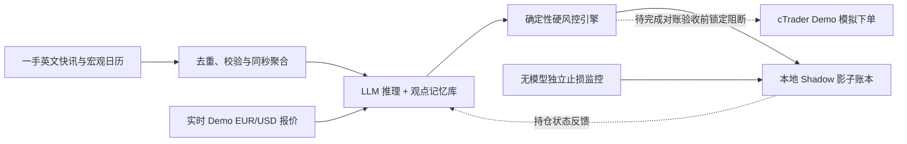

<p align="center">
  
</p>

<p align="center">
  <a href="README.md">English</a> · <strong>简体中文</strong>
</p>

<p align="center">
  <a href="https://github.com/lohis-aimbot/eventlens/actions/workflows/tests.yml"></a>
</p>

<p align="center">
  <strong>Python 3.11+</strong> &nbsp;·&nbsp; <strong>360 项自动化测试通过</strong> &nbsp;·&nbsp; <strong>Shadow 影子研究模式</strong> &nbsp;·&nbsp; <strong>纯 Demo 物理锁定</strong>
</p>

<p align="center">
  <a href="#项目简介">项目简介</a> ·
  <a href="#工作原理">工作原理</a> ·
  <a href="#核心能力全景">核心能力</a> ·
  <a href="#30-秒快速上手">快速上手</a> ·
  <a href="#云端常驻运行">24×5 云端</a> ·
  <a href="#实测证据与边界">实测证据</a> ·
  <a href="#路线图与前沿研究">路线图</a> ·
  <a href="#文档导航">文档导航</a>
</p>

---

## 项目简介

**EventLens** 是一个面向日内宏观交易研究的 Python 系统，核心围绕一条极简链路运转：**宏观事件（Event）→ 持续观点记忆（Thesis Memory）→ 风险受控仓位（Position）**。

当重大经济数据或央行决议发布时，系统调用现成的大模型 API（`DeepSeek`）解读事件与市场预期的偏差，更新保存在 SQLite 中的交易逻辑记忆，并提出日内 **EUR/USD（欧元/美元）** 目标仓位建议（预期持仓数分钟至数小时，当日内平仓）。

最关键的设计原则是：**大模型永远拿不到券商密钥，也没有最终决定权**。独立的确定性 Python 风控规则会对每一次建仓建议做严格核验（仓位上限、报价新鲜度、点差质量、新闻源延迟、每日 API 预算上限），并在完全不依赖大模型的情况下独立执行止损、止盈、移动止盈与超时平仓。

<table>
  <tr>
    <td width="25%" valign="top">
      <strong>01 · 实时感知 Observe</strong><br /><br />
      抓取一手英文宏观快讯与模拟盘实时双边报价，完整保留发布时间与本地到达时钟。
    </td>
    <td width="25%" valign="top">
      <strong>02 · 记忆推理 Reason</strong><br /><br />
      结合市场预期偏差与历史观点库输出结构化仓位建议，支持价格或时间触发的有界复盘。
    </td>
    <td width="25%" valign="top">
      <strong>03 · 独立风控 Govern</strong><br /><br />
      确定性规则把关杠杆、过期报价与滞后数据源；点值止损/止盈脱离大模型独立运行。
    </td>
    <td width="25%" valign="top">
      <strong>04 · 影子记账 Record</strong><br /><br />
      在本地 Shadow 账本中精细模拟点差、滑点与佣金，所有忽略与拒单记录全量留痕可查。
    </td>
  </tr>
</table>

> [!IMPORTANT]
> **诚实的研究边界声明：** EventLens 当前处于 **Shadow（本地影子模拟）研究阶段**。影子账本中的成交是基于实时 Demo 报价的本地模拟，并非真实券商成交，系统尚未证明扣除成本后的实盘稳定盈利能力。代码层面已物理阻断一切真实资金账户（Live），且模拟盘自动跟单下单功能在完成持仓精准平仓、成交回报确认与持久化对账验收前默认锁定关闭。

---

## 工作原理

整个系统仅由**单个 Python 进程 + 本地 SQLite 数据库**驱动——无需训练大模型、无需强化学习（RL）、无需微服务或多智能体框架。当前分析与仓位决策在单次 JSON 调用中完成（单次调用与“分析/决策双角色隔离”在可靠性、延迟和成本上的对比仍是开放研究课题）。



- **设计响应目标：** 在数据源与报价正常的前提下，从公开信息首次核实发布到进入决策流程的设计目标为 **`30–60 秒`**（这是工程设计目标，而非承诺的成交保证）。
- **事件范围：** 当前实验聚焦于 **EUR/USD** 宏观数据窗口作为标准试验田；未来可扩展的新闻类别（央行政策、能源、地缘政治、公司财报及社媒信号）仍保持开放探索。

---

## 核心能力全景

每一层都严格区分 **“AI 的主观推理”** 与 **“程序可验证的客观事实”**：

| 系统层级 | 目前已实现的功能 | 内置安全与审计保障 |
|---|---|---|
| **信息采集层** | 默认启用**一手英文宏观源组合**（`investingLive` 实时 HTML 流与问答补全、欧洲央行 `ECB`、美联储 `Fed`、美国经济分析局 `US BEA`、`Forex Factory` 周度日历）并保留华尔街见闻适配器；支持同一秒多指标并发打包（`--bundle-events`） | 严格区分计划时间、原始发布时间、页面显示时间、修改时间、本地接收时间与可用时间（未知的原始发布时间保持未知，绝不伪造）；无市场预期值时显式标注 `Consensus Forecast: MISSING`；4 维数据源健康诊断（HTTP 传输、CDN 缓存 `Age`、内容活跃度、可核验延迟） |
| **推理与记忆层** | `DeepSeek` 结构化 JSON 适配器；单次推理同时维护观点并给出仓位动作（`IGNORE_EVENT` / `HOLD` / `SET_TARGET` / `CLOSE`），支持原子级观点反转与因果价格轨迹输入；支持可选的**有状态观点重评**（`ReviewPolicy`：按到期时间、周期定时、突破点数或结构化价格条件触发复盘） | SQLite 观点版本不可变留痕（`sqlite_memory.py`）；`runtime_event_bundles` 崩溃恢复幂等不重调模型；严格区分可执行单句价格规则（如 `EUR/USD >= 1.1145`）与不可自动执行的自然语言条件；内置复盘冷却时间与调用次数上限（`runtime_reviews`） |
| **实时报价与成本层** | 纯 Python 无头 **`cTrader Open API` Demo 报价流**（直连 `demo.ctraderapi.com:5036` TLS/TCP）+ 本地桌面端 cBot 报价桥（`10–86400s`）+ 离线双边报价工具；支持 Pepperstone Razor 佣金元数据（每百万美元成交额 `30 USD`） | 基础策略默认拒绝零点差；默认 `pepperstone_razor_200` 配置仅对具备时钟溯源与佣金元数据的白名单源放行 `0.0 pip` 原始点差（可通过 `--no-allow-commission-zero-spread` 关闭）；严格隔离 `live_poll`（真实轮询）、`synthetic_fixture`（合成测试）与 `historical_bar_replay`（历史分钟线回放）数据血统 |
| **硬风控与保护层** | `DeterministicTargetValidator` 与 `DeterministicHardRiskEngine` 把关杠杆、最大仓位权重、等报价有效窗口（`awaiting_market_quote` → `expired`，与模型重试完全解耦）及 `--max-daily-llm-calls` 每日 UTC 调用熔断器 | 当新闻源滞后或降级时自动禁止新开仓/加仓，但始终放行 `CLOSE` 平仓与风控止损；基于点数（pips）的止损、止盈、移动追踪止盈、最长持仓计时、临近停机禁入缓冲与两阶段优雅排空平仓均**完全脱离大模型独立运行** |
| **影子账本与只读诊断** | 本地 `SQLiteShadowLedger` 精细核算模拟成交与费用；支持双资金档位模拟（默认 `pepperstone_razor_200` 模拟 `200 USD` 本金 + `200x` 杠杆；`--account-profile institutional_10k` 模拟 `10,000 USD` 无杠杆本金）；提供防前视偏差历史分钟线回放脚本（`scripts/run_historical_bar_replay.py`） | `shadow status` 与 `shadow report` 强制以 SQLite 只读模式（`?mode=ro`）打开，绝不建库、改表或触发跨日写操作，并提供有界锚点的窗口波动与事件后极值客观诊断；不同资金档位结果严禁混算；实盘地址/账户与 `--ctrader-demo-mirror-orders` 均被硬性拦截 |

---

## 30 秒快速上手

需要 **Python 3.11+**。以下离线体验命令**无需任何 API 密钥**即可直接运行：

```bash
python3 -m venv .venv
source .venv/bin/activate
python -m pip install -e '.[dev]'

# 查看全部命令行分组
eventlens --help

# 1. 将合成新闻/日历样例写入独立的离线演示数据库
eventlens observe demo examples/synthetic-observer.json

# 2. 用确定性硬风控校验一份样例仓位提案（不会发送任何订单）
eventlens research decision check examples/synthetic-position-proposal.json

# 3. 离线检查冻结的历史研究计划（不调用大模型）
eventlens research series plan examples/synthetic-series-plan.json
```

| 命令分组 | 用途说明 |
|---|---|
| `eventlens observe …` | 抓取一手英文宏观快讯（`capture`）、查看未来宏观数据时间表（`schedule`）与采集延迟报告（`report`） |
| `eventlens shadow …` | 启动或检查日内 Shadow 自动循环（`start`、`stop`、`status`、`report`、`recover`），支持定时窗口或 `--continuous` 常驻 |
| `eventlens memory …` | 查看持久化观点记忆、历史修订版本与独立记忆推理演示 |
| `eventlens source fed …` | 运行专门的美联储官方页面轮询采集器 |
| `eventlens research …` | 历史时间截断、防前视历史回放、成本底线测算与可选的历史 LLM 回测 |

<details>
<summary><strong>查看未来 EUR/USD 重磅宏观时间表并抓取实时快讯（无需 API 密钥）</strong></summary>

```bash
# 查看未来 36 小时欧元/美元重要宏观日历（同时显示北京时间与 UTC，缺失预期自动醒目标注 MISSING）
eventlens observe schedule --hours 36

# 对 investingLive、ECB、Fed、US BEA、Forex Factory 执行一次实时快照抓取
eventlens observe capture

# 离线读取本地抓取报告、版本修订与 4 维数据源健康状态
eventlens observe report
```

- 如需在断网环境下查看已缓存的日历，可使用 `eventlens observe schedule --offline`。
- 原有的 8 个 `eventlens-*` 独立命令及 `python -m eventlens.<模块>_cli` 调用方式全部保留兼容；Python 包结构统一归类于 `eventlens.sources.*`、`eventlens.trading.*` 与 `eventlens.research.*`。请勿将任何 API 密钥粘贴到聊天、代码或 Git 仓库中。
</details>

---

## 云端常驻运行

仓库内置了完整的 Ubuntu 24.04 + `systemd` 云端部署包（`deploy/gcp/`），无需再在本地电脑长开 cTrader 桌面端或每天手动点击 Start：

- **纯 Python 无头报价流（`ctrader_openapi.py`）：** 仅用 Python 标准库 `asyncio` + `ssl` 直连 `demo.ctraderapi.com:5036`，自动处理增量 Bid/Ask 缓存、每 `12 小时` 轮转报价会话，并在 Token 过期时自动刷新并以 `0600` 权限安全落盘。
- **双重 Demo 物理级硬锁：** `CTraderLiveEndpointForbiddenError` 拒绝任何含 `live` 的服务器域名；`CTraderLiveAccountForbiddenError` 在账户鉴权前强制核验 `isLive == False`，彻底锁死实盘账户。
- **24×5 常驻防护：** 自动识别外汇周末休市（纽约时间周五 `17:00` 至周日 `17:00`，自动适配夏令时/冬令时）并暂停抓新闻调模型；通过 `--max-daily-llm-calls` 锁定每日 UTC 大模型调用预算；收到 `systemctl stop`（`SIGTERM`）时优雅排空在途影子持仓。
- **当前边界：** 部署代码与离线协议测试已全部就绪；**跨多日的真实云端无人值守运行仍待前向验收**，且券商模拟盘跟单功能当前保持阻断关闭。

```bash
# 在 Ubuntu 24.04 云主机（如 GCP e2-small）上一键初始化环境与 systemd 服务
sudo bash deploy/gcp/setup_ubuntu.sh
sudo nano /etc/eventlens/eventlens.env   # 填入 DeepSeek 与 cTrader Demo 凭证（0600 权限）
sudo systemctl enable --now eventlens-shadow
```

完整云端配置与日常巡检手册 → **[docs/cloud-24x5-deployment.md](docs/cloud-24x5-deployment.md)**

---

## 实测证据与边界

EventLens 严格区分**离线自动化测试**、**已记录的真实窗口观测**、**已隔离的历史分钟线回放**与**尚未验证的目标**：

| 验证记录 | 实测数据与结果 | 说明了什么（以及客观局限） |
|---|---|---|
| **离线测试套件 · 2026-11-02** | **360 项测试全部通过**（`pytest`、`ruff`、`mypy`） | 在确定性模拟时钟下验证了状态机、硬风控、Open API 协议帧、Demo 安全锁、推进时钟复盘与模拟下单阻断 |
| **真实 Shadow 观测 · 2026-10-23** | 采集 **1,786 条实时报价**，6 次模型推理，5 个记忆版本，**2 笔模拟建仓**（接收至成交耗时 `4.974 s` 与 `14.151 s`），1 笔定时平仓 | 法国/德国 PMI 初值窗口的首次实测；当时尚未上线两阶段停机排空，两场运行之间存在约 5 分钟持仓空档 |
| **真实恢复与连续运行 · 2026-10-27** | 用新鲜实时报价平掉 10 月 23 日遗留持仓（`unclosed_risk = false`），随后完成 **2,240.0 秒不间断运行**（`3,517` 条有效报价，`0` 拒收，**10,761 次风控巡检**，持久化 `84` 条事件：过滤 `77` 条、`IGNORE_EVENT` `5` 条、陈旧报价拦截 `2` 条） | 验证了不回填历史价格的真实崩溃恢复、持仓期间零风控盲区、无超预期数据时不强行开仓，以及 `flat_completed` 干净收尾 |
| **异常现场记录 · 2026-10-29** | 欧洲央行窗口观测到 `investingLive` 旧版 RSS 出现 CloudFront `Age: 313s` 缓存延迟及中途本地报价桥中断 | 证明了 HTTP 返回正常不代表新闻新鲜（由此升级为未缓存实时 HTML 流与 4 维数据源健康门控） |
| **历史 FOMC 时间序列研究** | **8 场历史美联储决议回放**；`3/8` 通过证据校验（均为空仓观望）；双阶段平均耗时 `7.443 s`，单次 API 冒烟测试 `3.854 s` | 验证了长周期记忆连续性、结构校验与断点续跑能力，不构成预测准确率或盈利 alpha 证明 |

### 五级验证状态总览

| 状态等级 | 当前覆盖范围 |
|---|---|
| **已实现（Implemented）** | 一手英文源采集、无头 `cTrader Open API` Demo 报价流、`--continuous` 常驻运行、有状态观点复盘、每日模型预算熔断、历史回放数据血统隔离、只读 `status`/`report` 客观诊断 |
| **离线验证（Offline-Verified）** | `360` 项自动化测试覆盖协议编解码、实盘硬锁、周末休眠、崩溃恢复、时间戳分类学及风控/账本数学不变量 |
| **真实观测（Live-Observed）** | 2026 年 10 月 22–29 日原始 SQLite/JSONL 证据原样保存在本地未提交的 `data/` 目录中（详见[验收报告](docs/shadow-acceptance.md)）。10 月 28 日基于雅虎 1 分钟 K 线的临时回放已[单独隔离勘误](docs/replay-errata-2026-10-28.md)，不作为秒级实盘成交依据 |
| **待前向验收（Pending Acceptance）** | 跨多日云端无人值守连续运行、`investingLive` 实时 HTML 通道前向延迟验收、有状态观点复盘实盘效果评估，以及多窗口扣费后策略表现评估 |
| **已阻断关闭（Unavailable）** | 任何真实资金账户交易，以及模拟盘自动映射下单（`--ctrader-demo-mirror-orders` 在完成按持仓 ID 平仓、成交确认与持久化对账验收前强制拦截） |

---

## 路线图与前沿研究

- [x] **基础底座** — 强类型契约、不可变 SQLite 证据与观点记忆库、结构化模型适配器。
- [x] **历史研究工具** — 严格防前视偏差（`as_of`）回放、成本核算与支持断点续跑的实验框架。
- [x] **模块化工程重构** — 清晰拆分 `sources/`、`trading/` 与 `research/`，完整保留旧版命令行兼容。
- [ ] **实时观测器** — 多源采集、Razor 佣金溯源与无头 Open API 报价流已实现；跨多日连续观测待验收。
- [ ] **Shadow 闭环与保护** — 硬风控、点值止损/止盈/移动追踪、真实恢复与 `2,240s` 连续窗口已记录；需积累更多完整开平仓周期样本。
- [ ] **cTrader Demo 隔离执行** — 在 Shadow 连续验收通过后，接入感知 `positionId` 的模拟盘平仓与权威持仓对账。

### 中长期前沿研究方向

所有远期研究扩展均严格服从于独立硬风控，且必须在实测中证明优于更简单的基线方案后才会采纳：

| 研究支柱 | 当前阶段 | 通俗目标说明 |
|---|---|---|
| **神经符号执行治理与形式化安全验证** | **当前核心支柱** | 将随机的大模型语义理解与确定性的 Python 符号风控彻底解耦，并进一步引入有状态属性测试（`Hypothesis`）与形式化定理证明（`Z3`），验证断流、跨日与排空期间的安全不变量 |
| **条件生成式市场世界模型** | **中期研究** | 针对重磅宏观事件样本稀缺的问题，离线生成事件发布后的价格跳空、点差拉宽与流动性枯竭轨迹，对仓位与止损规则做反事实压力测试 |
| **自激微观结构状态检测（Hawkes 点过程）** | **中期研究** | 用霍克斯（Hawkes）点过程刻画密集突发快讯与亚秒级 Tick 加速簇，识别知情交易流与逆向选择风险，动态收紧入场门控与止盈止损 |
| **正则化程序策略搜索** | **远期受控研究** | 将进化式程序/参数搜索（FunSearch / Eureka 范式）严格限制在有界的平仓与执行参数空间内，并通过滚动前向验证与缩水夏普比率（DSR）防止过拟合 |

---

## 文档导航

| 文档 | 内容概览 |
|---|---|
| **[系统架构与模块地图](docs/architecture.md)** | 数据契约、运行时状态机与神经符号风控边界 |
| **[云端连续部署手册](docs/cloud-24x5-deployment.md)** | Ubuntu 24.04 `systemd` 部署、`cTrader Open API` Demo 配置、周末休眠与预算熔断 |
| **[信息采集与时钟规范](docs/observer.md)** | 新闻抓取、发布/到达时间戳分类与 4 维流健康度（附[采集验收标准](docs/observer-acceptance.md)） |
| **[实时报价与成本策略](docs/live-quotes.md)** | 双边报价新鲜度、Razor 零点差佣金白名单策略与因果对齐（附[报价验收标准](docs/live-quotes-acceptance.md)） |
| **[观点记忆与推理配置](docs/memory.md)** | 观点生命周期、修订规则与 [LLM 密钥安全配置](docs/reasoning.md) |
| **[Shadow 实测验收报告](docs/shadow-acceptance.md)** | 2026 年 10 月完整实测记录、恢复日志及 [10 月 28 日回放隔离说明](docs/replay-errata-2026-10-28.md) |
| **[历史 FOMC 系列研究](docs/research/fomc-series-acceptance.md)** | 8 场美联储决议实验、[历史行情局限](docs/research/fomc-2025-data-quality.md)与[历史回放推理](docs/research/replay-inference.md) |
| **[阶段路线图](docs/roadmap.md)** | 各阶段准入条件与长期研究演进里程碑 |
| **[双语网页版概览](docs/index.html)** | 独立双语（`中文 / EN`）产品级可视化网页源码，支持本地浏览器直接打开预览 |
