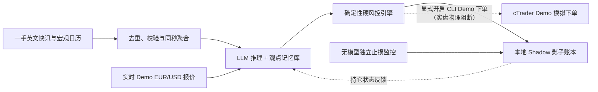

<p align="center">
  
</p>

<p align="center">
  <a href="README.md">English</a> · <strong>简体中文</strong>
</p>

<p align="center">
  <a href="https://github.com/lohis-aimbot/eventlens/actions/workflows/tests.yml"></a>
</p>

<p align="center">
  <strong>Python 3.11+</strong> &nbsp;·&nbsp; <strong>377 项自动化测试</strong> &nbsp;·&nbsp; <strong>Shadow 与显式 Demo 模式</strong> &nbsp;·&nbsp; <strong>仅限 Demo</strong>
</p>

<p align="center">
  <a href="#项目简介">项目简介</a> ·
  <a href="#工作原理">工作原理</a> ·
  <a href="#核心能力全景">核心能力</a> ·
  <a href="#30-秒快速上手">快速上手</a> ·
  <a href="#云端常驻运行">24×5 云端</a> ·
  <a href="#实测证据与边界">实测证据</a> ·
  <a href="#路线图与前沿研究">路线图</a> ·
  <a href="#文档导航">文档导航</a>
</p>

---

## 项目简介

> [!IMPORTANT]
> **运行进度 · 2026 年 11 月 11 日。** Python 自动化验证已通过 **377 项测试**、Ruff 与 mypy，涵盖基于 `HistoricalTrade` `ClosingDealId` 的真实平仓回执记账、跨日断连/重启下的 `demo_daily_state` 保守基线风控，以及 `UsdPerOneLot` / `UsdPerMillionUsdVolume` 双格式 Razor 佣金元数据。在 Ubuntu 24.04 GCP 云主机上，最终版 `EventLensCliBridge.algo`（`TargetFramework=net6.0`，锁定 `cTrader.Automate 1.0.21`，`BUILD_UID_GID=0:0`）已零错误零警告编译通过，完成 `--network none --user 1654:1654` 断网元数据检查，通过只读 `demo-reconcile`（`clean: true`）与有界 `1,000 EUR` Pepperstone Demo `demo-smoke` 真单闭环（`passed: true`，止损挂单确认、`ClosingDealId` 核验、`flat_after_close: true`），并已启动 `24×5` 云端 Demo 连续观测。早期预检记录与边界说明参见[云端预检审计](docs/research/2026-11-11-cloud-preflight-audit.md)与[云端部署手册](docs/cloud-24x5-deployment.md)。

**EventLens** 是一个面向日内宏观交易研究的 Python 系统，核心围绕一条极简链路运转：**宏观事件（Event）→ 持续观点记忆（Thesis Memory）→ 风险受控仓位（Position）**。

当重大经济数据或央行决议发布时，系统调用现成的大模型 API（`DeepSeek`）解读事件与市场预期的偏差，更新保存在 SQLite 中的交易逻辑记忆，并提出日内 **EUR/USD（欧元/美元）** 目标仓位建议（预期持仓数分钟至数小时，当日内平仓）。

最关键的设计原则是：**大模型永远拿不到券商密钥，也没有最终决定权**。独立的确定性 Python 风控规则会对每一次建仓建议做严格核验（仓位上限、报价新鲜度、点差质量、新闻源延迟、每日 API 预算上限），并在完全不依赖大模型的情况下独立执行止损、止盈、移动止盈与超时平仓。

<table>
  <tr>
    <td width="25%" valign="top">
      <strong>01 · 实时感知 Observe</strong><br /><br />
      抓取一手英文宏观快讯与模拟盘实时双边报价，完整保留发布时间与本地到达时钟。
    </td>
    <td width="25%" valign="top">
      <strong>02 · 记忆推理 Reason</strong><br /><br />
      结合市场预期偏差与历史观点库输出结构化仓位建议，支持价格或时间触发的有界复盘。
    </td>
    <td width="25%" valign="top">
      <strong>03 · 独立风控 Govern</strong><br /><br />
      确定性规则把关杠杆、过期报价与滞后数据源；点值止损/止盈脱离大模型独立运行。
    </td>
    <td width="25%" valign="top">
      <strong>04 · 影子记账 Record</strong><br /><br />
      在本地 Shadow 账本中精细模拟点差、滑点与佣金，所有忽略与拒单记录全量留痕可查。
    </td>
  </tr>
</table>

> [!IMPORTANT]
> **诚实的研究边界声明：** EventLens 默认以本地 **Shadow（影子模拟）模式**运行（`CTRADER_ALLOW_DEMO_ORDERS=false`）；CLI Demo 自动下单必须显式开启双重确认（`--ctrader-cli-demo-orders --confirm-demo-execution`）并严格绑定非实盘账户（`!Account.IsLive`）。通过有界 Demo 冒烟仅代表无头执行与对账链路打通——**扣除成本后的策略长期盈利能力与多日无人值守稳定性仍在持续前向观测评估中，尚未被证明**。代码层面物理阻断一切真实资金账户（Live）及旧版 `--ctrader-demo-mirror-orders`。

---

## 工作原理

当前主干仅由**单个 Python 进程 + 本地 SQLite 数据库**驱动——无需自训大模型、无需微服务或多智能体框架。当前分析与仓位决策在单次 JSON 调用中完成（单次调用与“分析/决策双角色隔离”在可靠性、延迟和成本上的对比仍是开放研究课题）。



- **设计响应目标：** 在数据源与报价正常的前提下，从公开信息首次核实发布到进入决策流程的设计目标为 **`30–60 秒`**（这是工程设计目标，而非承诺的成交保证）。
- **事件范围：** 当前实验聚焦于 **EUR/USD** 宏观数据窗口作为标准试验田；未来可扩展的新闻类别（央行政策、能源、地缘政治、公司财报及社媒信号）仍保持开放探索。

---

## 核心能力全景

每一层都严格区分 **“AI 的主观推理”** 与 **“程序可验证的客观事实”**：

| 系统层级 | 目前已实现的功能 | 内置安全与审计保障 |
|---|---|---|
| **信息采集层** | 默认启用**一手英文宏观源组合**（`investingLive` 实时 HTML 流与问答补全、欧洲央行 `ECB`、美联储 `Fed`、美国经济分析局 `US BEA`、`Forex Factory` 周度日历）并保留华尔街见闻适配器；支持同一秒多指标并发打包（`--bundle-events`） | 严格区分计划时间、原始发布时间、页面显示时间、修改时间、本地接收时间与可用时间（未知的原始发布时间保持未知，绝不伪造）；无市场预期值时显式标注 `Consensus Forecast: MISSING`；4 维数据源健康诊断（HTTP 传输、CDN 缓存 `Age`、内容活跃度、可核验延迟） |
| **推理与记忆层** | `DeepSeek` 结构化 JSON 适配器；单次推理同时维护观点并给出仓位动作（`IGNORE_EVENT` / `HOLD` / `SET_TARGET` / `CLOSE`），支持原子级观点反转与因果价格轨迹输入；支持可选的**有状态观点重评**（`ReviewPolicy`：按到期时间、周期定时、突破点数或结构化价格条件触发复盘） | SQLite 观点版本不可变留痕（`sqlite_memory.py`）；`runtime_event_bundles` 崩溃恢复幂等不重调模型；严格区分可执行单句价格规则（如 `EUR/USD >= 1.1145`）与不可自动执行的自然语言条件；内置复盘冷却时间与调用次数上限（`runtime_reviews`） |
| **实时报价与成本层** | Docker **`cTrader CLI` 无头 Demo 桥接**（`EventLensCliBridge`，`12h` 自动滚动切分）+ 纯 Python **`cTrader Open API` Demo 报价流**（直连 `demo.ctraderapi.com:5036` TLS/TCP）+ 本地桌面端 cBot 报价桥（`10–86400s`）+ 离线双边报价工具；支持 Pepperstone Razor 双格式佣金元数据（`UsdPerMillionUsdVolume` 每百万美元 `30 USD` 与 `UsdPerOneLot` 每标准手单边 `3 USD`） | 基础策略默认拒绝零点差；默认 `pepperstone_razor_200` 配置仅对具备时钟溯源与可信佣金元数据的白名单源放行 `0.0 pip` 原始点差（可通过 `--no-allow-commission-zero-spread` 关闭）；严格隔离 `live_poll`（真实轮询）、`synthetic_fixture`（合成测试）与 `historical_bar_replay`（历史分钟线回放）数据血统 |
| **硬风控与保护层** | `DeterministicTargetValidator` 与 `DeterministicHardRiskEngine` 把关杠杆、最大仓位权重、基于置信度 `q` 的事前单笔风险预算、跨日断连保守基线（`demo_daily_state`）、等报价有效窗口（`awaiting_market_quote` → `expired`）及 `--max-daily-llm-calls` 每日 UTC 调用熔断器 | 当新闻源滞后或降级时自动禁止新开仓/加仓，但始终放行 `CLOSE` 平仓与风控止损；基于点数（pips）的止损、止盈、移动追踪止盈、最长持仓计时、临近停机禁入缓冲与两阶段优雅排空平仓均**完全脱离大模型独立运行** |
| **影子与 Demo 账本** | 本地 `SQLiteShadowLedger` 模拟核算 + 显式启用的 `CTraderCliDemoExecutionEngine`（基于唯一 `ClosingDealId` 真实成交回执记账与 `position_closed_unpriced` 保护）；支持双资金档位模拟（默认 `pepperstone_razor_200` 模拟 `200 USD` / `200x`；`--account-profile institutional_10k` 模拟 `10,000 USD` / `1x`）；防前视偏差历史分钟线回放（`scripts/run_historical_bar_replay.py`） | `shadow status` 与 `shadow report` 强制以 SQLite 只读模式（`?mode=ro`）打开，绝不建库、改表或触发跨日写操作，并提供有界锚点的窗口波动与事件后极值客观诊断；不同资金档位结果严禁混算；实盘地址/账户与 `--ctrader-demo-mirror-orders` 均被硬性拦截 |

---

## 30 秒快速上手

需要 **Python 3.11+**。以下离线体验命令**无需任何 API 密钥**即可直接运行：

```bash
python3 -m venv .venv
source .venv/bin/activate
python -m pip install -e '.[dev]'

# 查看全部命令行分组
eventlens --help

# 1. 将合成新闻/日历样例写入独立的离线演示数据库
eventlens observe demo examples/synthetic-observer.json

# 2. 用确定性硬风控校验一份样例仓位提案（不会发送任何订单）
eventlens research decision check examples/synthetic-position-proposal.json

# 3. 离线检查冻结的历史研究计划（不调用大模型）
eventlens research series plan examples/synthetic-series-plan.json
```

| 命令分组 | 用途说明 |
|---|---|
| `eventlens observe …` | 抓取一手英文宏观快讯（`capture`）、查看未来宏观数据时间表（`schedule`）与采集延迟报告（`report`） |
| `eventlens shadow …` | 启动或检查日内 Shadow / 显式 CLI Demo 自动循环（`start`、`stop`、`status`、`report`、`recover`、`demo-reconcile`、`demo-smoke`、`demo-unlock`），支持定时窗口或 `--continuous` 常驻 |
| `eventlens memory …` | 查看持久化观点记忆、历史修订版本与独立记忆推理演示 |
| `eventlens source fed …` | 运行专门的美联储官方页面轮询采集器 |
| `eventlens research …` | 历史时间截断、防前视历史回放、成本底线测算与可选的历史 LLM 回测 |

<details>
<summary><strong>查看未来 EUR/USD 重磅宏观时间表并抓取实时快讯（无需 API 密钥）</strong></summary>

```bash
# 查看未来 36 小时欧元/美元重要宏观日历（同时显示北京时间与 UTC，缺失预期自动醒目标注 MISSING）
eventlens observe schedule --hours 36

# 对 investingLive、ECB、Fed、US BEA、Forex Factory 执行一次实时快照抓取
eventlens observe capture

# 离线读取本地抓取报告、版本修订与 4 维数据源健康状态
eventlens observe report
```

- 如需在断网环境下查看已缓存的日历，可使用 `eventlens observe schedule --offline`。
- 原有的 8 个 `eventlens-*` 独立命令及 `python -m eventlens.<模块>_cli` 调用方式全部保留兼容；Python 包结构统一归类于 `eventlens.sources.*`、`eventlens.trading.*` 与 `eventlens.research.*`。请勿将任何 API 密钥粘贴到聊天、代码或 Git 仓库中。
</details>

---

## 云端常驻运行

仓库包含面向 `x86_64` Ubuntu 24.04 + `systemd` 的无头云端部署套件（`deploy/gcp/`），无需本机长期开着桌面端 cTrader 即可运行 `24×5` 连续观测：

- **主要路线：Docker `cTrader CLI` 桥接（`ctrader/EventLensCliBridge/` + `eventlens-ctrader-cli.service`）。** 通过固定摘要的微软 `.NET 8 SDK` 容器编译 `TargetFramework=net6.0` 的 `EventLensCliBridge.algo`（`cTrader.Automate` 锁包固定 `[1.0.21]`），在固定摘要的 Spotware 官方 Linux 控制台容器中运行（隔离 `DEEPSEEK_API_KEY`，启用 `--exit-on-stop` 安全退出），输出 `12h` 滚动 `EURUSD` Demo 报价流、带 `(bridge_session_id, event_seq)` 的 `reconcile_snapshot` 对账快照，以及显式开启时受 `!Account.IsLive` 与 `DeterministicHardRiskEngine` 双重把关的 `positionId` / `ClosingDealId` Demo 模拟执行。
- **替代路线：Open API 只读报价（`ctrader_openapi.py`）。** 使用纯 Python `asyncio` + `ssl` 直连 `demo.ctraderapi.com:5036` 获取增量报价与刷新 Token；旧版 `--ctrader-demo-mirror-orders` 保持物理阻断。
- **24×5 常驻防护：** 基于置信度 `q` 的事前风险预算定仓（`--max-risk-per-trade-pct 0.02`）、跨日停机/重启下的 `demo_daily_state` 保守亏损基线、自动识别外汇周末休市（纽约时间周五 `17:00` 至周日 `17:00`，自动适配夏令时/冬令时）、`--max-daily-llm-calls` 每日 UTC 预算熔断，以及 `SIGTERM` 两阶段停机排空。
- **当前边界：** 最终版 `EventLensCliBridge.algo` 已在 Ubuntu 24.04 云端用 `BUILD_UID_GID=0:0` 编译通过（SHA-256 `24d5b3996d783ccafa91109e3b7d137993897eda86128ee3`），通过 `--network none --user 1654:1654` 断网元数据核验，并完成 Phase 1 只读 `demo-reconcile`（`clean: true`）与 Phase 2 有界 `1,000 EUR` Pepperstone Demo `demo-smoke`（`passed: true`，止损确认、真实 `ClosingDealId` 成交核验、平仓后空仓对账干净），现已启动 `24×5` 常驻观测服务。任意非 root 构建 UID 与非 root 真实账户容器运行暂未采纳（容器使用上游默认 root，宿主机 `/var/lib/eventlens/bridge` 通过 setgid + ACL 最小化授权），**跨多日无人值守稳定性与扣费后策略收益表现仍在持续前向评估中**。

```bash
# 1. 在 x86_64 Ubuntu 24.04 云主机上初始化环境并完成锁包构建 + 断网元数据检查
sudo bash deploy/gcp/setup_ubuntu.sh
sudo env BUILD_UID_GID=0:0 bash /opt/eventlens/deploy/gcp/build_ctrader_algo.sh

# 2. 执行只读 Demo 持仓对账（Phase 1）；有界 1,000 EUR 冒烟与 24×5 常驻启动详见部署手册第 5 节
sudo -u eventlens /opt/eventlens/.venv/bin/eventlens-shadow demo-reconcile --ctrader-cli-bridge-dir /var/lib/eventlens/bridge
```

完整云端配置与日常巡检手册 → **[docs/cloud-24x5-deployment.md](docs/cloud-24x5-deployment.md)**

---

## 实测证据与边界

EventLens 严格区分**离线自动化测试**、**已记录的真实窗口观测**、**已隔离的历史分钟线回放**与**尚未验证的目标**：

| 验证记录 | 实测数据与结果 | 说明了什么（以及客观局限） |
|---|---|---|
| **云端 CLI Demo 冒烟与 377 项测试 · 2026-11-11** | 最终版 `EventLensCliBridge.algo`（`net6.0`，`cTrader.Automate 1.0.21`）零错误编译并通过断网元数据核验；**`377` 项 Python 测试**、Ruff 与 mypy 全部通过；完成 Pepperstone Demo `demo-reconcile`（`clean: true`）与有界 `1,000 EUR` `demo-smoke`（`passed: true`，挂止损确认、`HistoricalTrade.ClosingDealId` 真实回执核验、`flat_after_close: true`）并启动 `24×5` 常驻 | 验证了无头 CLI Demo 真单开平仓、Razor `UsdPerOneLot` 零点差佣金白名单与平仓因果对账闭环；**不构成**多日稳定性或策略正收益 alpha 证明 |
| **云端预检基线 · 2026-11-11** | 私有 Ubuntu 云主机环境就绪；前序预检快照成功编译 `.algo` 并通过断网元数据检查；终版修复前独立复跑 `373` 项 Python 测试通过 | 保留部署前审计基线（记录固定容器摘要、`BUILD_UID_GID=0:0` 约束及预检问题），详见[预检审计报告](docs/research/2026-11-11-cloud-preflight-audit.md) |
| **离线测试套件 · 2026-11-11** | **377 项测试全部通过**（`pytest`、`ruff`、`mypy`） | 在确定性时钟与模拟守护进程下验证了状态机、硬风控、`UsdPerOneLot`/`UsdPerMillionUsdVolume` 佣金元数据、平仓快照时序竞态防护、`ClosingDealId` 记账、跨日风控基线与实盘阻断 |
| **真实 Shadow 观测 · 2026-10-23** | 采集 **1,786 条实时报价**，6 次模型推理，5 个记忆版本，**2 笔模拟建仓**（接收至成交耗时 `4.974 s` 与 `14.151 s`），1 笔定时平仓 | 法国/德国 PMI 初值窗口的首次实测；当时尚未上线两阶段停机排空，两场运行之间存在约 5 分钟持仓空档 |
| **真实恢复与连续运行 · 2026-10-27** | 用新鲜实时报价平掉 10 月 23 日遗留持仓（`unclosed_risk = false`），随后完成 **2,240.0 秒不间断运行**（`3,517` 条有效报价，`0` 拒收，**10,761 次风控巡检**，持久化 `84` 条事件：过滤 `77` 条、`IGNORE_EVENT` `5` 条、陈旧报价拦截 `2` 条） | 验证了不回填历史价格的真实崩溃恢复、持仓期间零风控盲区、无超预期数据时不强行开仓，以及 `flat_completed` 干净收尾 |
| **异常现场记录 · 2026-10-29** | 欧洲央行窗口观测到 `investingLive` 旧版 RSS 出现 CloudFront `Age: 313s` 缓存延迟及中途本地报价桥中断 | 证明了 HTTP 返回正常不代表新闻新鲜（由此升级为未缓存实时 HTML 流与 4 维数据源健康门控） |
| **历史 FOMC 时间序列研究** | **8 场历史美联储决议回放**；`3/8` 通过证据校验（均为空仓观望）；双阶段平均耗时 `7.443 s`，单次 API 冒烟测试 `3.854 s` | 验证了长周期记忆连续性、结构校验与断点续跑能力，不构成预测准确率或盈利 alpha 证明 |

### 五级验证状态总览

| 状态等级 | 当前覆盖范围 |
|---|---|
| **已实现（Implemented）** | 一手英文源采集、`MacroSemantics` 与滞后补抓防护、`single-pass-agent-v3.1` 证据核验、基于 `q` 的事前风险预算定仓、Docker `cTrader CLI` 桥接（`EventLensCliBridge`）+ `CTraderCliDemoExecutionEngine` / `CTraderCliDemoBrokerAdapter`、原生 Open API 报价流，以及 `status`/`report`/`demo-reconcile`/`demo-smoke`/`demo-unlock` 命令行 |
| **离线验证（Offline-Verified）** | **`377` 项自动化测试**、Ruff 与 mypy 全部通过，覆盖 11 月 4 日跨夜故障序列、`12h` 报价轮转（`>4` 文件）、`UsdPerOneLot` Razor 佣金元数据、平仓快照与 `order_event` 竞态保护、`ClosingDealId` 真实平仓记账、跨日 `demo_daily_state` 保守基线、UTC 意图过期 TTL、`unknown_execution` 人工解锁与实盘账户阻断 |
| **真实观测（Live-Observed）** | 2026 年 11 月 11 日 Ubuntu 24.04 GCP 云端 `EventLensCliBridge` Pepperstone Demo `demo-reconcile`（`clean: true`）、有界 `1,000 EUR` `demo-smoke`（`passed: true`）及正在运行的 `24×5` 常驻观测；另有 2026 年 10 月 22 日至 11 月 6 日原始 SQLite/JSONL 证据保存在未提交的 `data/` 目录中（详见[验收报告](docs/shadow-acceptance.md)与 [11 月 4 日跨夜审计](docs/research/overnight-20261104-shadow-audit-and-prompt-draft.md)）。10 月 28 日基于雅虎 1 分钟 K 线的临时回放已[单独隔离勘误](docs/replay-errata-2026-10-28.md) |
| **待前向验收（Pending Acceptance）** | 跨多日无人值守 `24×5` 云端连续观测窗口、跨周末休市自动恢复记录、`ctrader-console` 非 root 真实账户运行（当前使用上游默认 root），以及多窗口扣费后策略收益表现评估 |
| **已阻断关闭（Unavailable）** | 任何真实资金账户（Live）交易（`!Account.IsLive` / `LiveAccountForbiddenError`）及旧版 Open API 差额映射下单（`--ctrader-demo-mirror-orders`） |

---

## 路线图与前沿研究

- [x] **基础底座** — 强类型契约、不可变 SQLite 证据与观点记忆库、结构化模型适配器。
- [x] **历史研究工具** — 严格防前视偏差（`as_of`）回放、成本核算与支持断点续跑的实验框架。
- [x] **模块化工程重构** — 清晰拆分 `sources/`、`trading/` 与 `research/`，完整保留旧版命令行兼容。
- [ ] **实时观测器** — 多源采集、Razor 佣金溯源与无头 Demo 报价流已实现；跨多日连续观测进行中。
- [ ] **Shadow 闭环与保护** — 硬风控、点值止损/止盈/移动追踪、真实恢复与 `2,240s` 连续窗口已记录；正在积累更多完整开平仓周期样本。
- [ ] **cTrader Demo 隔离执行** — 基于 Docker `cTrader CLI` 的 `positionId` / `ClosingDealId` 显式 Demo 执行与云端有界 `demo-smoke` 已跑通；跨多日前向窗口待验收。

### 中长期前沿研究方向

未来的演进围绕一条清晰的**三步协同闭环**展开——**确定性风控保底 → 世界模型造高保真训练场 → `FinRL` 训练精细化进出场**——所有扩展均受独立硬风控约束，且必须在实测中优于更简单的基线规则后才会采纳：

| 研究支柱 | 定位与阶段 | 通俗目标说明 |
|---|---|---|
| **神经符号风控治理与形式化安全验证** | **当前保命底座** | 大模型只负责宏观语义解读，Python 确定性规则管住资金底线；进一步引入有状态属性测试（`Hypothesis`）与形式化证明（`Z3`），把断网、跨夜与停机排空等极端巧合下的安全漏洞彻底堵死 |
| **条件生成式市场世界模型（World Model）** | **核心重点方向** | 针对非农、CPI、央行决议一年仅几十次、历史样本太少的痛点，打造逼真的离线“飞行模拟器”，生成数据公布后的跳空、点差暴涨与插针洗盘轨迹，用于高强度反事实压力测试与策略训练 |
| **基于世界模型的强化学习执行与平仓（`FinRL`）** | **核心协同方向** | 不让强化学习在稀缺新闻上死记硬背（大方向仍由大模型拍板），而是让 `FinRL` 智能体（`PPO` / `SAC`）在“世界模型”生成的海量模拟盘口中专门训练分批入场、动态移动止盈与时间衰减平仓，且输出动作仍须通过硬风控审批与滚动前向检验 |

---

## 文档导航

| 文档 | 内容概览 |
|---|---|
| **[系统架构与模块地图](docs/architecture.md)** | 数据契约、运行时状态机与神经符号风控边界 |
| **[云端连续部署手册](docs/cloud-24x5-deployment.md)** | Ubuntu 24.04 `systemd` + Docker `cTrader CLI` Demo 桥接、`demo-reconcile`/`demo-smoke`、周末休眠与预算熔断 |
| **[信息采集与时钟规范](docs/observer.md)** | 新闻抓取、发布/到达时间戳分类与 4 维流健康度（附[采集验收标准](docs/observer-acceptance.md)） |
| **[实时报价与成本策略](docs/live-quotes.md)** | 双边报价新鲜度、Razor 零点差佣金白名单策略与因果对齐（附[报价验收标准](docs/live-quotes-acceptance.md)） |
| **[观点记忆与推理配置](docs/memory.md)** | 观点生命周期、修订规则与 [LLM 密钥安全配置](docs/reasoning.md) |
| **[Shadow 实测验收报告](docs/shadow-acceptance.md)** | 2026 年 10 月完整实测记录、恢复日志及 [10 月 28 日回放隔离说明](docs/replay-errata-2026-10-28.md) |
| **[历史 FOMC 系列研究](docs/research/fomc-series-acceptance.md)** | 8 场美联储决议实验、[历史行情局限](docs/research/fomc-2025-data-quality.md)与[历史回放推理](docs/research/replay-inference.md) |
| **[阶段路线图](docs/roadmap.md)** | 各阶段准入条件与长期研究演进里程碑 |
| **[双语网页版概览](docs/index.html)** | 独立双语（`中文 / EN`）产品级可视化网页源码，支持本地浏览器直接打开预览 |
