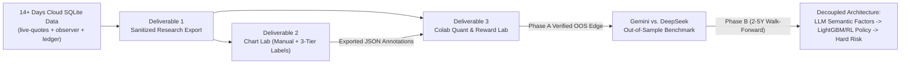

<p align="center">
  <a href="blueprint-v2.md"><strong>English</strong></a> · <a href="blueprint-v2_CN.md">简体中文</a> &nbsp;|&nbsp;
  <a href="../README.md">Repository Home</a> &nbsp;·&nbsp;
  <a href="https://lohis-aimbot.github.io/eventlens/dashboard/">Live Web Dashboard ↗</a>
</p>

# EventLens Research & Engineering Blueprint v2

> **Decision Date:** November 24–25, 2026  
> **Scope:** Stage 0 safety halt + Stages 1–4 empirical research & ML decoupling roadmap  
> **Operational Status:** `--kill-switch` active on the `24×5` GCP Demo VM (`0` open positions; live tick & Tier-1 macro collection running continuously)

---

## Executive Summary

Following the November 11–24, 2026 forward-evaluation window on a live Pepperstone Demo account (`200 USD / 200x` Razor profile), EventLens has pivoted from **prompt-first parameter tuning** to an **empirical data-first scientific workflow**.

Rather than tweaking stop/take-profit thresholds blindly after live losses, the system is grounded in **14+ days of continuous real cloud EUR/USD tick quotes** (`live-quotes.sqlite`, ~377 MB) synchronized with **arrival-clocked Tier-1 English macro news** (`observer.sqlite`, ~2.45 GB) and audited execution logs (`shadow-ledger.sqlite`). This blueprint locks in the signed-off architecture across Stages 0 through 4: halting unvalidated Demo entries, reverse-engineering true intraday EUR/USD edge in an offline Colab Quant & Reward Lab, adding an interactive K-line annotation workbench (`Chart Lab`), benchmarking **Gemini vs. DeepSeek** out-of-sample, and defining a strict Walk-Forward gate before re-enabling Demo execution.

---

## 1. Stage 0 · Operational Safety Halt & Continuous Telemetry

| Control | Current State | Purpose |
|---|---|---|
| `--kill-switch` | **Active** (`2026-11-24`) | `DeterministicHardRiskEngine` physically blocks all new Demo order entries; open exposure verified flat (`0` positions) |
| `eventlens-ctrader-cli.service` | **Running (`24×5`)** | Streams headless Pepperstone Demo EUR/USD bid/ask ticks into `live-quotes.sqlite` |
| `eventlens-shadow-cli.service` | **Running (`24×5`)** | Captures Tier-1 English news with exact arrival clocks (`observer.sqlite`) and audits skipped proposals without placing orders |
| `eventlens-dashboard-sync.timer` | **Running (`24×5`)** | Publishes strictly sanitized runtime telemetry to the live Web Dashboard |

---

## 2. Empirical Forensic Autopsy (Nov 11 – Nov 24, 2026)

### Portfolio Summary (`pepperstone_razor_200` Live Demo Profile)

- **Equity Trajectory:** `176.10 USD` → `164.48 USD` (`-6.6%`, holding `24.48 USD` above the `140 USD` hard equity floor)
- **Executed Trades:** `6` closed trades — **`0W / 6L` (`0%` win rate)**
- **Net PnL:** `-11.62 USD` (gross `-10.90 USD`, commissions `0.72 USD`), average `-9.1 pips`
- **Maximum Favorable Excursion (MFE) Range:** `[+0.2p, +8.5p]` — **zero trades reached `+10.0 pips`**

### Trade-by-Trade Forensic Ledger

| Date | Prompt | Side | Trigger & Session Context | Net Pips / USD & Exit | MFE / MAE | 1h / 4h / 12h Drift | Forensic Diagnosis |
|---|---|---|---|---|---|---|---|
| `2026-11-13` | `v3.2` | Short | Fed Collins remarks | `-6.7p` / `-1.46 USD` (`15m` timeout) | `+0.2p` / `-8.3p` | `-5.7p` / `+1.8p` / `+5.4p` | Chased a `30m` `-20.3p` local floor |
| `2026-11-18` | `v4.0` | Short | European session news wrap | `-14.0p` / `-2.92 USD` (`14p` SL) | `+6.1p` / `-13.9p` | `-13.1p` / `-2.8p` / `-14.5p` | Reacted to session-roundup noise |
| `2026-11-19` | `v4.0` | Short | FOMC Minutes release | `-3.7p` / `-0.86 USD` (NY close cutoff) | **`+8.5p`** / `-6.6p` | `+5.5p` / `-2.1p` / `+0.9p` | `22p` trailing activation far too wide |
| `2026-11-19` | `v4.0` | Short | NYT Iran strikes (`03:11 UTC` Asian) | `-14.0p` / `-2.92 USD` (`14p` SL) | `+1.0p` / `-13.7p` | `-4.4p` / `-15.4p` / `-32.3p` | Asian floor-chase reversed on London open |
| `2026-11-19` | `v4.0` | Long | Philly Fed (`6.3` vs `20.0`) | `-14.1p` / `-2.94 USD` (`14p` SL) | **`+8.5p`** / `-13.7p` | `+4.0p` / `-15.6p` / `-26.2p` | Tier-2 data spike failed against USD trend |
| `2026-11-24` | `v4.1` | Short | Fed Williams (`23:09 UTC` Asian dead zone) | `-2.0p` / `-0.52 USD` (`5h` timeout) | `+3.9p` / `-13.0p` | `+1.3p` / `-2.5p` / `+4.6p` | Entered during illiquid Asian session |

### Three Root-Cause Engineering Discoveries

1. **Payoff-Structure Mismatch (`MFE <= +8.5p` vs `14p SL / 42p TP`):** Every trade peaked between `+0.2p` and `+8.5p` while operating without higher-timeframe (`1H / 4H / Daily`) market structure context or FX liquidity-session gating. Static `14p / 42p` brackets forced positive-drift trades (`+8.5p` on FOMC Minutes and Philly Fed) to expire or reverse into stops.
2. **Singleton `thesis_id` Review Deadlock:** `ReviewPolicy.max_reviews_per_thesis` (`default=3`, defined in `src/eventlens/runtime.py:181`, enforced at `src/eventlens/runtime.py:3607`, and wired in `src/eventlens/shadow_cli.py:1672`) tracks lifetime review counts per `thesis_id`. When prompt `v4` consolidated pullback monitoring under a single persistent thesis (`MARKET_STATE_WATCH_THESIS_ID = "market-state-watch"` in `src/eventlens/trading/agent.py:35`), `step_reviews()` silently hit the lifetime cap of `3` on November 16 and froze. Consequently, **all 42 pullback `watch_condition` triggers generated under `v4.1` (Nov 19–23) produced `0` runtime reviews**. This bug is intentionally held in reserve to ship alongside the post-Stage-A validated strategy release rather than rushing an unverified hotfix back to Demo.
3. **Pre-Filter Noise Suppression Confirmed:** Upgrading to `TIER1_FILTER_VERSION = "tier1-eurusd-filter-v2"` (`src/eventlens/sources/english_tier1.py:69`) plus 300-second revision cooldowns and empty-delta suppression cut daily LLM calls from `80/day` (hitting the daily budget ceiling) down to **`~24–27/day`**, blocking 48 non-G2/single-stock headlines, 37 rapid-revision bursts, 19 empty-delta updates, and 17 session roundups.

---

## 3. Stage 1 · Staged Architectural Ladder (`Phase A → Phase B`)



- **Phase A (Active Now — Empirical Reverse-Engineering & Benchmark):** Run on the 14+ day real cloud dataset (`live-quotes.sqlite` + `observer.sqlite`). Discover which macro catalysts, FX sessions, and HTF contexts actually precede clean intraday moves, construct a standardized Net-R reward benchmark, and curate structured experience/case memory.
- **Phase B (Gated on Positive Out-of-Sample Alpha in Phase A):** Scale to 2–5 years of historical macro calendars and EUR/USD market bars. Decouple **LLM semantic factor extraction** (surprise magnitude, policy tone, geopolitical tail severity) from a **Colab-trained lightweight ML/reward decision & exit layer** (e.g., LightGBM / regularized policy selector) validated by **Walk-Forward Optimization** (`60%` train / `20%` parameter plateau validation / `20%` unseen test), while keeping `DeterministicHardRiskEngine` immutable.

---

## 4. Stage 2 · Dual Labeling, 4 FX Sessions & Bidirectional Causal Attribution

### Dual Opportunity Labeling (No Hindsight-Only Illusions)

| Label Source | Definition | Purpose |
|---|---|---|
| **Algo Tier 1 · Short Scalp** | Future `90m` window achieves `MFE >= +10p` with `MAE <= 8p` | Captures crisp initial macro-impulse follow-through |
| **Algo Tier 2 · Mid Swing** | Future `4h` window achieves `MFE >= +15p` with `MAE <= 10p` | Identifies session-continuation swings |
| **Algo Tier 3 · Large Swing** | Future `8h` window achieves `MFE >= +25p` with `MAE <= 15p` | Captures major macro repricing days |
| **Manual Boss Labels** | Human `Buy / Sell / Avoid` annotations placed in `Chart Lab` | Captures visual structure, liquidity traps, and false breakouts missed by fixed thresholds |

### Session & Bidirectional Causal Windows

- **4 FX Liquidity Sessions:** Every event and opportunity is bucketed into **`Asian`**, **`London`**, **`London-NY Overlap`**, or **`Late NY`** so Asian liquidity droughts cannot pollute London/NY statistics.
- **Bidirectional News Attribution:** Each labeled K-line pivot searches both:
  1. **Post-Arrival Causal Windows (`0m → +15m`, `+15m → +60m`):** What Tier-1 news actually arrived and moved price cleanly after local receipt?
  2. **Pre-Arrival Front-Running / Feed-Lag Diagnostic (`-60m → 0m`, highlighting `-5m`):** Did price already break out before the scraped feed arrived (exposing publisher CDN lag or consensus leakage)?

---

## 5. Stage 3 · Standardized Net-R Reward Function, Exit Templates & Anti-Overfitting

### Standardized Risk-Adjusted Reward (`Net R`)

All evaluations convert raw pips into net risk-normalized multiples **`R`** (`1R` = initial stop-loss dollar risk) **after deducting real Bid/Ask spreads and Pepperstone Razor commissions (`3 USD` per standard lot per side)**:

- **Active Entry (`Buy` / `Sell`):**

```math
\text{Score}_{\text{entry}} = R_{\text{net}} - \lambda_{\text{mae}} \cdot \max\!\left(0,\ \frac{|\text{MAE}|}{\text{SL}} - 0.70\right)
```

Near-stop sweating (`> 70%` of stop distance) is explicitly penalized so lucky reversals do not inflate model scores.

- **Flat Decision (`HOLD` / `IGNORE_EVENT`):**
  - `-alpha_miss * R_best` (`alpha_miss ≈ 0.30`) if an objectively qualified Tier 1–3 setup occurred, gently discouraging permanent inaction without forcing negative-EV entries.
  - `+alpha_avoid` (`≈ +0.25R`) if staying flat dodged a whipsaw trap where both directions would stop out.
  - `0` otherwise.

### Four Exit Templates + Natural Drift Reference

Every signal is scored simultaneously across four realistic execution templates alongside passive **`30m / 1h / 4h` natural market drift**:

| Template | Stop Loss | Take Profit / Trailing | Max Holding Horizon |
|---|---|---|---|
| **T1 · Short Scalp** | `10 pips` | `15 pips` fixed | `90 minutes` |
| **T2 · Mid Swing** | `14 pips` | `24 pips` + trailing stop | `4 hours` |
| **T3 · Large Swing** | `18 pips` | `36 pips` | `8 hours` |
| **T4 · Dynamic ATR** | `ATR`-scaled | `ATR`-scaled | Dynamic session-bounded |

### Out-of-Sample Discipline

- **Phase A:** Strict chronological **`70%` discovery / `30%` blind out-of-sample test** split; prompt tweaks, thresholds, and model rankings are judged solely on the unseen `30%`.
- **Phase B:** **Walk-Forward Optimization (`60% / 20% / 20%`)** selecting parameter **plateaus** (neighborhood stability) rather than sharp overfitted peaks.

---

## 6. Stage 4 · Deliverables, Model Arena & Go-Live Gate

### Staged Implementation Plan

1. **Deliverable 1 — Read-Only Cloud Export Pipeline:** Extract sanitized slices from `live-quotes.sqlite`, `observer.sqlite`, and `shadow-ledger.sqlite` into a reproducible research bundle (`M1/M5/M15/H1` OHLC + Bid/Ask spread statistics + arrival-clocked events).
2. **Deliverable 2 — Interactive Desktop & Mobile `Chart Lab`:** Add a 3rd tab (`Chart Lab`) inside the existing bilingual Web Dashboard (`docs/dashboard/index.html`, supporting both GitHub Pages and local server mode) featuring TradingView-style K-line zoom/pan, overlaid Algo Tier 1–3 markers, clicked-bar `±60m` news inspection, `Buy / Sell / Avoid` manual labeling persisted in browser `localStorage`, and 1-click JSON export/import for Colab.
3. **Deliverable 3 — Colab Quant & Reward Lab Notebook:** Build OHLCV + bidirectional news attribution tables, evaluate the 4 exit templates, and run a **Gemini vs. DeepSeek** head-to-head out-of-sample reward benchmark.

### Strict Go-Live Gate

- `--kill-switch` stays **ON** until a candidate configuration demonstrates positive after-cost expectancy on the blind out-of-sample split and receives explicit operator approval.
- The `max_reviews_per_thesis` singleton `"market-state-watch"` deadlock fix (`src/eventlens/runtime.py:181,3607`) is held cleanly for coordinated release alongside the validated strategy upgrade.
