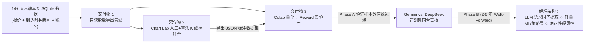

<p align="center">
  <a href="blueprint-v2.md">English</a> · <a href="blueprint-v2_CN.md"><strong>简体中文</strong></a> &nbsp;|&nbsp;
  <a href="../README_CN.md">返回中文主页</a> &nbsp;·&nbsp;
  <a href="https://lohis-aimbot.github.io/eventlens/dashboard/">在线实时看板 ↗</a>
</p>

# EventLens 研究与工程蓝图 v2（总指挥对齐版）

> **拍板日期：** 2026 年 11 月 24–25 日  
> **覆盖范围：** 第 0 关紧急止血 + 第 1–4 关经验反推、因果归因与机器学习解耦路线  
> **当前云端状态：** GCP `24×5` 主机已开启 `--kill-switch`（当前 `0` 持仓；继续不间断采集真实 Tick 报价与一手英文快讯）

---

## 核心摘要

在复盘 **2026 年 11 月 11 日至 11 月 24 日** Pepperstone Demo（`200 USD / 200x` Razor 档位）的真实前向运行数据后，EventLens 正式从 **“凭经验调 Prompt / 拍脑袋改止盈止损参数”** 转向 **“以真实数据与量化基准为核心”** 的科学迭代路线。

目前云端主机已持续沉淀超过 **14 天真实连续 EUR/USD 盘口报价**（`live-quotes.sqlite`，约 377 MB）、严格保留到达时钟的一手英文宏观新闻（`observer.sqlite`，约 2.45 GB）以及完整决策审计账本（`shadow-ledger.sqlite`）。本蓝图锁定第 0–4 关全部决策：保持物理停单只采数据，在 Colab 离线量化实验室逆向标注高胜率买点与客观 Reward 基准，在 Web 看板中上线桌面与手机双端交互式 `Chart Lab`（K 线标注实验室），开展 **Gemini vs. DeepSeek** 盲测集同台打擂，并以严格样本外正期望作为恢复模拟下单的唯一准入门槛。

---

## 1. 第 0 关 · 安全停单止血与持续数据沉淀

| 控制组件 | 当前状态 | 工程作用 |
|---|---|---|
| `--kill-switch` | **已激活（`2026-11-24`）** | `DeterministicHardRiskEngine` 物理拦截所有新开仓指令，并确认当前账户空仓（`0` 持仓） |
| `eventlens-ctrader-cli.service` | **运行中（`24×5`）** | 通过无头 Docker Bridge 持续采集 Pepperstone Demo EUR/USD 双边报价至 `live-quotes.sqlite` |
| `eventlens-shadow-cli.service` | **运行中（`24×5`）** | 持续抓取一手英文宏观源并记录精确到达时钟（`observer.sqlite`），审计策略提案但不发送订单 |
| `eventlens-dashboard-sync.timer` | **运行中（`24×5`）** | 定时发布脱敏后的运行状态快照至 GitHub Pages 在线双语看板 |

---

## 2. 真实 Demo 前向运行深度法医复盘（2026-11-11 至 2026-11-24）

### 账面与极值统计（`pepperstone_razor_200` 模拟实况档）

- **净值变化：** `176.10 USD` → `164.48 USD`（回撤 `-6.6%`，距离 `140 USD` 硬止损底线仍有 `24.48 USD` 缓冲）
- **实盘成交笔数：** 共 `6` 笔已平仓交易 —— **`0` 胜 / `6` 负（胜率 `0%`）**
- **累计净盈亏：** `-11.62 USD`（毛利 `-10.90 USD`，佣金 `-0.72 USD`），单笔均亏 `-9.1 pips`
- **最大浮盈（MFE）分布：** 全场 `6` 笔最高浮盈仅落在 **`[+0.2p, +8.5p]`** —— **没有任何一笔触及过 `+10.0 pips`**

### 6 笔真实交易全量拆解表

| 日期 | Prompt | 方向 | 触发事件与时段 | 净盈亏与平仓原因 | 最大浮盈 / 最大浮亏 | 入场后 1h / 4h / 12h 走势 | 法医级诊断 |
|---|---|---|---|---|---|---|---|
| `2026-11-13` | `v3.2` | 做空 | 美联储 Collins 讲话 | `-6.7p` / `-1.46 USD`（`15m` 超时） | `+0.2p` / `-8.3p` | `-5.7p` / `+1.8p` / `+5.4p` | 在 30 分钟急跌 `-20.3p` 底部追空 |
| `2026-11-18` | `v4.0` | 做空 | 欧洲时段新闻综述 | `-14.0p` / `-2.92 USD`（`14p` 止损） | `+6.1p` / `-13.9p` | `-13.1p` / `-2.8p` / `-14.5p` | 综述类噪声触发无效入场 |
| `2026-11-19` | `v4.0` | 做空 | 美联储会议纪要 | `-3.7p` / `-0.86 USD`（收盘强平） | **`+8.5p`** / `-6.6p` | `+5.5p` / `-2.1p` / `+0.9p` | `22p` 移动止盈激活门槛过宽 |
| `2026-11-19` | `v4.0` | 做空 | NYT 伊朗空袭新闻（`03:11 UTC` 亚盘） | `-14.0p` / `-2.92 USD`（`14p` 止损） | `+1.0p` / `-13.7p` | `-4.4p` / `-15.4p` / `-32.3p` | 亚盘追跌地板价，伦敦开盘即反抽 |
| `2026-11-19` | `v4.0` | 做多 | 费城联储制造业（`6.3` vs `20.0`） | `-14.1p` / `-2.94 USD`（`14p` 止损） | **`+8.5p`** / `-13.7p` | `+4.0p` / `-15.6p` / `-26.2p` | 次级数据脉冲逆美元强趋势失效 |
| `2026-11-24` | `v4.1` | 做空 | 美联储 Williams 讲话（`23:09 UTC` 亚盘） | `-2.0p` / `-0.52 USD`（`5h` 超时） | `+3.9p` / `-13.0p` | `+1.3p` / `-2.5p` / `+4.6p` | 亚盘流动性极度匮乏 |

### 三项核心根因发现

1. **赔率结构与波段空间严重错配：** 在缺乏高周期（`1H / 4H / Daily`）趋势背景与交易时段约束下，`6` 笔交易的最大浮盈仅在 `+0.2p` 到 `+8.5p` 之间，而系统原先设置 `14p SL / 42p TP`（移动止盈需 `+22p` 才启动），直接导致美联储纪要与费城联储两笔一度浮盈 `+8.5p` 的单子全部回吐甚至止损。
2. **隐藏工程 Bug 定位（`thesis_id` 单例复盘死锁）：** `ReviewPolicy.max_reviews_per_thesis`（默认 `3` 次，定义于 `src/eventlens/runtime.py:181`，拦截逻辑在 `src/eventlens/runtime.py:3607`，参数传入于 `src/eventlens/shadow_cli.py:1672`）按 `thesis_id` 累计**终身**复盘次数。由于 `v4` 架构将全部回调观察统一挂载到单例 `MARKET_STATE_WATCH_THESIS_ID = "market-state-watch"`（`src/eventlens/trading/agent.py:35`），`step_reviews()` 在 11 月 16 日用满 3 次额度后彻底停摆。这导致 **`v4.1`（11 月 19–23 日）下发的 42 个回调观察条件实际复盘次数为 `0`**。按总指挥决策，该 Bug 修复留待 Phase A 研究验证完成后随新版策略一并打包上线。
3. **`v4.1` 前置降噪门控生效：** 上线 `TIER1_FILTER_VERSION = "tier1-eurusd-filter-v2"`（`src/eventlens/sources/english_tier1.py:69`）、300 秒修订冷却与空文本增量抑制后，每日模型调用量从撞上限的 **`80 次/天`** 降至 **`约 24–27 次/天`**，成功拦截 48 条非 G2/个股消息、37 次高频修稿、19 次无实质增量推送与 17 篇市场综述。

---

## 3. 第 1 关 · 两阶段工程演进阶梯（`Phase A → Phase B`）



- **Phase A（当前阶段 — 真实云端样本逆向工程与打分基准）：** 基于连续 14+ 天云端真实 EUR/USD Tick 与到达时钟快讯，从行情反推理想入场点、构建标准化净 `R` 评分函数、沉淀典型正反例经验库。
- **Phase B（待 Phase A 样本外验证正期望后解锁）：** 将数据扩展至 2–5 年历史宏观日历与 EUR/USD K 线；将 **LLM 语义因子提取**（预期偏差、政策倾向、地缘尾部冲击）与 **Colab 训练的轻量级机器学习决策/出场模型**（如 LightGBM / 正则化策略层）解耦，经由 **Walk-Forward 滚动前向验证（`60%` 训练 / `20%` 参数高原筛选 / `20%` 盲测）** 后接入系统，同时保持 `DeterministicHardRiskEngine` 物理不可绕过。

---

## 4. 第 2 关 · 双轨标注、4 大外汇时段与双向因果归因

### 双轨机会标注（避免“唯阈值事后诸葛亮”）

| 标注类别 | 客观定义 | 核心作用 |
|---|---|---|
| **算法一级 · 短脉冲** | 未来 `90 分钟` 满足 `MFE >= +10p` 且 `MAE <= 8p` | 捕捉数据/讲话落地后的干净日内冲量 |
| **算法二级 · 中波段** | 未来 `4 小时` 满足 `MFE >= +15p` 且 `MAE <= 10p` | 识别跨时段延续性单边行情 |
| **算法三级 · 大波段** | 未来 `8 小时` 满足 `MFE >= +25p` 且 `MAE <= 15p` | 捕捉高影响力宏观重定价行情 |
| **老板人工标注** | 在 `Chart Lab` K 线上手动标记 `买入 / 卖出 / 回避` | 弥补纯数学阈值看不懂的盘口陷阱、假突破与支撑阻力 |

### 4 时段切分与双向新闻窗口归因

- **4 大流动性时段隔离：** 全部 K 线与事件按 **`亚盘（Asian）` / `欧盘（London）` / `欧美重叠（Overlap）` / `美盘尾盘（Late NY）`** 独立分桶统计，杜绝流动性枯竭时段干扰主时段阈值。
- **双向因果搜索（抓“因果”也抓“抢跑/源滞后”）：**
  1. **到达后因果窗（`0 → +15m`、`+15m → +60m`）：** 检验新闻本地接收后，行情是否产生低回撤可持续位移。
  2. **到达前抢跑诊断窗（`-60m → 0m`，高亮 `-5m`）：** 检验采集源到达前价格是否已提前走完（直接暴露新闻源 CDN 延迟或预期提前泄露）。

---

## 5. 第 3 关 · 标准化 Net-R 评分函数、4 套出场模板与防过拟合纪律

### 风险标准化净收益评估（`Net R`）

所有评估均扣除**真实 Bid/Ask 点差与 Pepperstone Razor 佣金（单边 `3 USD / 标准手`）**，并以初始止损风险作为 `1R` 基准：

- **主动入场得分（`Buy / Sell`）：**

```math
\text{Score}_{\text{entry}} = R_{\text{net}} - \lambda_{\text{mae}} \cdot \max\!\left(0,\ \frac{|\text{MAE}|}{\text{SL}} - 0.70\right)
```

若单笔交易浮亏深度超过止损距离的 `70%`（即使侥幸扛回），将受到重罚，避免激励高危扛单策略。

- **观望/忽略得分（`HOLD / IGNORE_EVENT`）：**
  - 若错过算法一至三级合格单边行情，记轻惩罚 `-alpha_miss * R_best`（`alpha_miss ≈ 0.30`），督促抓高确定性机会但不逼迫模型乱开负期望单；
  - 若成功躲过双向洗盘打损陷阱，记正向避险奖励 `+alpha_avoid`（`≈ +0.25R`）；
  - 其余普通噪声市场记 `0` 分。

### 4 套并发出场模板 + 自然漂移对照列

每次标注和回测同时计算 4 套止盈止损模板，并对照 **`30m / 1h / 4h` 被动自然走势**：

| 出场模板 | 止损（SL） | 止盈 / 移动止盈（TP） | 最长持仓时限 |
|---|---|---|---|
| **T1 · 短线快进快出** | `10 pips` | `15 pips` 固定止盈 | `90 分钟` |
| **T2 · 日内中波段** | `14 pips` | `24 pips` + 移动保本锁盈 | `4 小时` |
| **T3 · 大波段延伸** | `18 pips` | `36 pips` | `8 小时` |
| **T4 · 动态波动率** | 动态 `ATR` 倍数 | 动态 `ATR` 倍数 | 随当前时段弹性收口 |

### 样本外防过拟合铁律

- **Phase A：** 严格按时间轴 **`70%` 探索集 / `30%` 盲测集**切分；任何 Prompt、过滤词与规则对比均以盲测集（`30%`）表现为准。
- **Phase B：** 执行 **`60% / 20% / 20%` Walk-Forward 滚动检验**，只采用在参数邻域呈稳健“高原”的参数组，剔除孤立尖峰过拟合点。

---

## 6. 第 4 关 · 工程交付清单、模型竞技场与重启闸门

### 本阶段三大核心交付物

1. **交付物 1 — 只读云端 14 天数据导出管线：** 安全导出 `live-quotes.sqlite`、`observer.sqlite` 与 `shadow-ledger.sqlite`，生成离线标准研究包（含 `M1/M5/M15/H1` K 线、真实点差分布与精确到达时钟事件流）。
2. **交付物 2 — 桌面/手机双端 `Chart Lab` K 线标注台：** 在现有双语 Web 看板（`docs/dashboard/index.html`）新增第 3 个主 Tab `K 线标注实验室`，支持鼠标滚轮与手机触摸缩放、叠加算法 1/2/3 级标记、点选任意 K 线查看前后 `±60m` 新闻，并将老板的 `买入 / 卖出 / 回避` 标注存入浏览器 `localStorage`，支持一键导出/导入 JSON 同步给 Colab。
3. **交付物 3 — Colab 量化与 Reward 评估实验室：** 一键重建多周期 K 线与双向新闻归因矩阵，计算 4 套出场模板净 `R` 收益，并开展 **Gemini vs. DeepSeek** 盲测集离线打擂（综合得分更高者赢得后续模拟盘资格）。

### 严格重启准入门槛（Go-Live Gate）

- 保持云端 `--kill-switch` 持续生效，直至候选策略与模型在样本外盲测集中跑出稳定正期望并获得总指挥人工签字放行。
- 隐藏的 `"market-state-watch"` `max_reviews_per_thesis` 单例复盘死锁修复（`src/eventlens/runtime.py:181,3607`）将在确认新策略有效后，与新策略版本一并发布上线。
